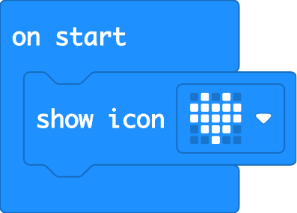
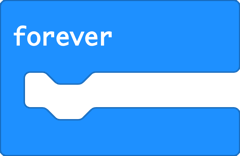
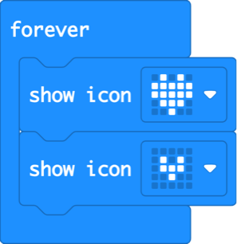
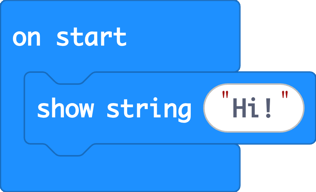
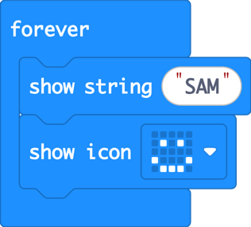
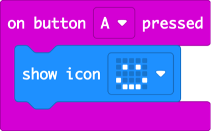
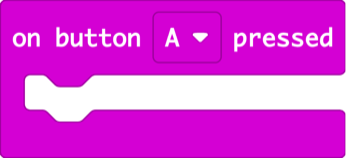
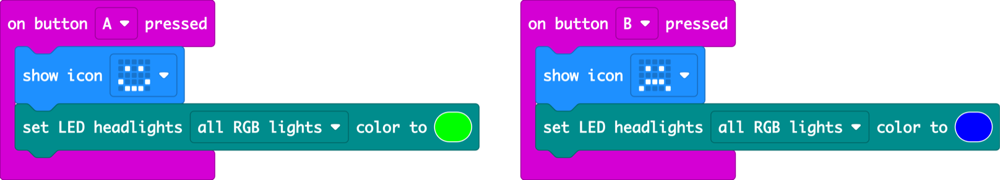

Lesson 1 · first contact, no experience needed · 60 min

Pupils meet a tiny computer, write their very first program, and finish by making a badge that shows how they feel, with the robot’s lights changing colour to match.

## Intro: Meet the micro:bit and MakeCode

_10 min · no computers for 3 min_

### Hook (3 min)

> **Say:** “Hands up if you think there’s a computer in a phone. In a car? In a washing machine? In a birthday card that plays music? Computers are hiding everywhere, and today you get your own. It’s smaller than a bank card.”

Hand out the micro:bits. Let pupils find: the **25 red lights** (the LED screen), **button A** and **button B**, and the USB socket. Tell them nothing will break if they touch it.

### Tour (7 min)

On the projector, show the four parts of MakeCode. Pupils copy you on their computers.

1. Open [makecode.microbit.org](https://makecode.microbit.org) → **New Project** → type a name → **Create**.
2. **The drawers** (middle column): Basic, Input, Music… Each drawer holds blocks of one colour.
3. **The workspace** (big white area): where you build. Drag a block in, drag it back to the drawers to delete it.
4. **The simulator** (left): a pretend micro:bit. It runs your code instantly, so you can test without the real one.
5. **Download** (bottom left): sends your program to the real micro:bit over the USB cable. The first time, click **⋯ → Connect device** and follow the steps (this works in Chrome and Edge; in other browsers, drag the downloaded file onto the **MICROBIT** drive).

Say clearly: **you cannot break anything by trying.** Undo (the curved arrow) fixes any mistake.

---

## 1.1 Heartbeat

_14 min · first block, forever loop_

### Hook (2 min)

> **Say:** “Put two fingers on your neck. Feel that? Your heart beats about 80 times a minute, all day, without you thinking about it. Today we give the micro:bit a heart.”

> **Ask:** What does a heart do, again and again? (It gets big, then small, then big…)

### Demo (5 min)

1. A new project already has **on start** and **forever**. **on start** runs once, when the micro:bit switches on.
2. Open the **Basic** drawer and drag **show icon** into **on start**. It clicks into place.
3. Click the little picture and choose the heart. Look: the simulator shows it straight away.
4. Download it to the real micro:bit together. This is everyone’s first program!



<details>
<summary>Copy the code for this picture (paste into MakeCode JavaScript view)</summary>

```ts
basic.showIcon(IconNames.Heart)
```

</details>

### Build (7 min)

#### Challenge

Make the heart beat: big heart, small heart, big heart, small heart… forever.

- Use the **forever** block instead of **on start**: it repeats without stopping.
- You need two **show icon** blocks.

#### Blocks you’ll need

-  Basic

-  Basic **(new)**

**Solution**



<details>
<summary>Copy the code for this picture (paste into MakeCode JavaScript view)</summary>

```ts
basic.forever(function () {
    basic.showIcon(IconNames.Heart)
    basic.showIcon(IconNames.SmallHeart)
})
```

</details>

#### Watch out for

- The block is floating on its own, not clicked in. Floating blocks look faded and don’t run.
- Both blocks show the same heart: then nothing seems to move.
- The download “does nothing”: check the cable is plugged in and that the device was connected.

#### Fast finishers

- Add a **pause** block (Basic) to make a slow, sleepy heartbeat.
- Make a racing heart: what makes it faster?

---

## 1.2 Name badge

_14 min · text, order of blocks_

### Hook (2 min)

> **Say:** “At conferences, people wear name badges so others know who they are. Ours will be the only badge in the school that scrolls!”

> **Ask:** The screen is only 5 lights wide. How can it show a long name?

### Demo (5 min)

1. From **Basic**, drag **show string** into **on start**. “String” is what coders call text.
2. Click the word inside and type **Hi!**. Watch it scroll across the simulator, one letter at a time.
3. Point out: the program runs **top to bottom**. The order of the blocks is the order things happen.



<details>
<summary>Copy the code for this picture (paste into MakeCode JavaScript view)</summary>

```ts
basic.showString("Hi!")
```

</details>

### Build (7 min)

#### Challenge

Make a name badge that scrolls your name, then shows a smiley face, again and again.

- Which block repeats forever? You used it in the heartbeat.

#### Blocks you’ll need

-  Basic

-  Basic **(new)**

-  Basic

**Solution**



<details>
<summary>Copy the code for this picture (paste into MakeCode JavaScript view)</summary>

```ts
basic.forever(function () {
    basic.showString("SAM")
    basic.showIcon(IconNames.Happy)
})
```

</details>

#### Watch out for

- The name only shows once: it’s in **on start**, not **forever**.
- Long names take a long time to scroll. That’s normal.

#### Fast finishers

- Add your favourite hobby or animal icon after your name.
- Slot the micro:bit into the Cutebot Pro and switch it on: the robot’s battery powers it, so your badge works without the computer. Walk your robot badge around the room.

---

## 1.3 Mood badge

_19 min · events (buttons), extension, headlights_

### Hook (2 min)

> **Say:** “Your badge says your name. But how are you feeling today? A mood badge lets you change your face with the press of a button, and the robot will glow in your mood’s colour.”

> **Ask:** If you were a colour right now, what colour would you be? Why?

### Demo (7 min)

1. Start a **new project**. From **Input**, drag **on button A pressed**. This is an **event**: the blocks inside wait until the button is pressed.
2. Put **show icon** with a happy face inside. Press A on the simulator.



<details>
<summary>Copy the code for this picture (paste into MakeCode JavaScript view)</summary>

```ts
input.onButtonPressed(Button.A, function () {
    basic.showIcon(IconNames.Happy)
})
```

</details>

3. Now meet the robot: slide the micro:bit into the Cutebot Pro’s slot, as shown in the kit’s instructions.
4. Add the robot blocks: **Extensions** → search `cutebot pro` → choose **Cutebot Pro** by ELECFREAKS. A new teal drawer appears.
5. Show **set LED headlights all RGB lights color to** and the colour picker. Don’t build the whole thing: that’s their job.

### Build (10 min)

#### Challenge

Build a mood badge. Button A: happy face and a happy colour on the robot’s lights. Button B: sad face and a sad colour.

- You need two button events: one for A, one for B (change the letter in the dropdown).
- Switch the robot on to see the headlights.

#### Blocks you’ll need

-  Cutebot Pro **(new)**

-  Basic

-  Input **(new)**

**Solution**



<details>
<summary>Copy the code for this picture (paste into MakeCode JavaScript view)</summary>

```ts
input.onButtonPressed(Button.A, function () {
    basic.showIcon(IconNames.Happy)
    CutebotPro.colorLight(CutebotProRGBLight.RGBA, 0x00ff00)
})
input.onButtonPressed(Button.B, function () {
    basic.showIcon(IconNames.Sad)
    CutebotPro.colorLight(CutebotProRGBLight.RGBA, 0x0000ff)
})
```

</details>

#### Watch out for

- No teal Cutebot Pro drawer: the extension wasn’t added, or they picked plain “Cutebot”.
- Two “button A” events: MakeCode greys one out. Change one to B.
- Headlights stay dark: the robot’s power switch is off.

#### Fast finishers

- Add a third mood on **A+B** (surprised? sleepy?).
- Give each headlight its own colour with **left RGB** / **right RGB**.

### Wrap (3 min)

Colour check: everyone presses a button at the same time and the room lights up. Pupils can pick any mood, real or pretend.

> **Say:** “Today you gave a computer a heart, a name and feelings. Next lesson the robot wakes up: those buttons will make it drive.”

---
[← Start here](/exercises/makecode/robotics/cutebot/start/) [Lesson 2: Wake up your robot →](/exercises/makecode/robotics/cutebot/lesson-2/)
