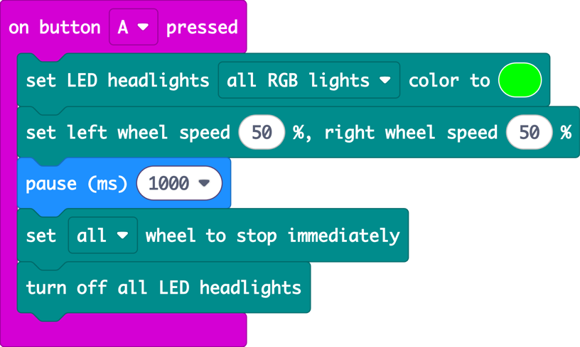
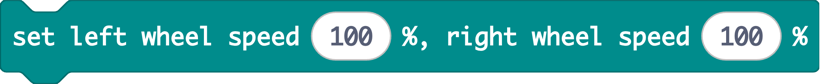
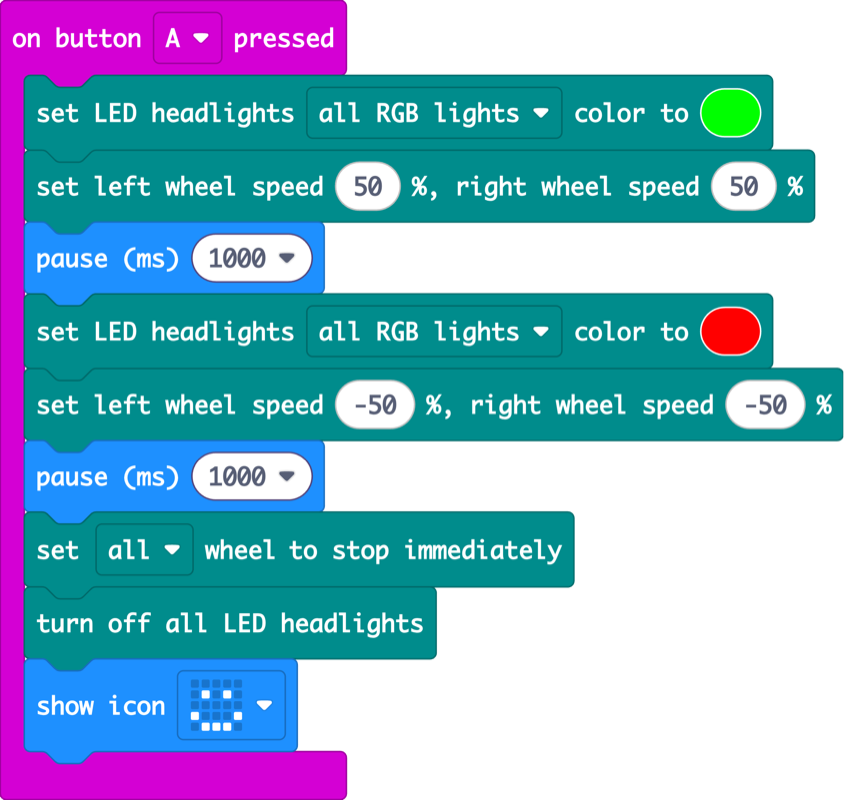
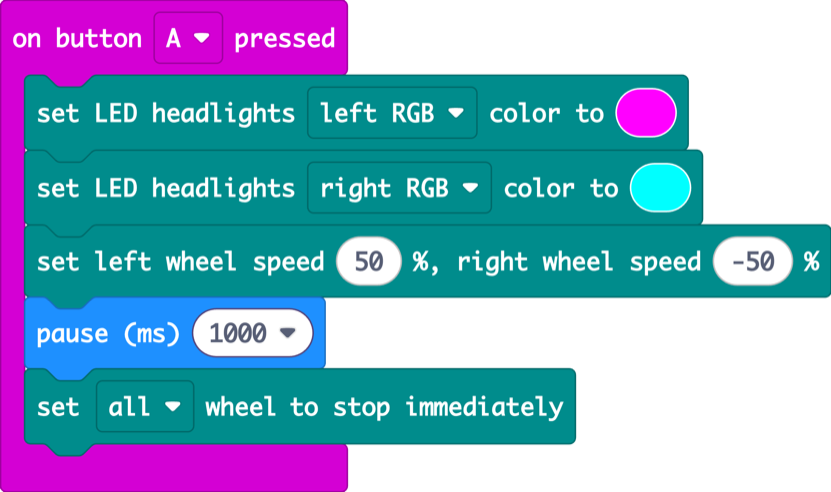
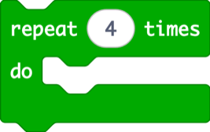
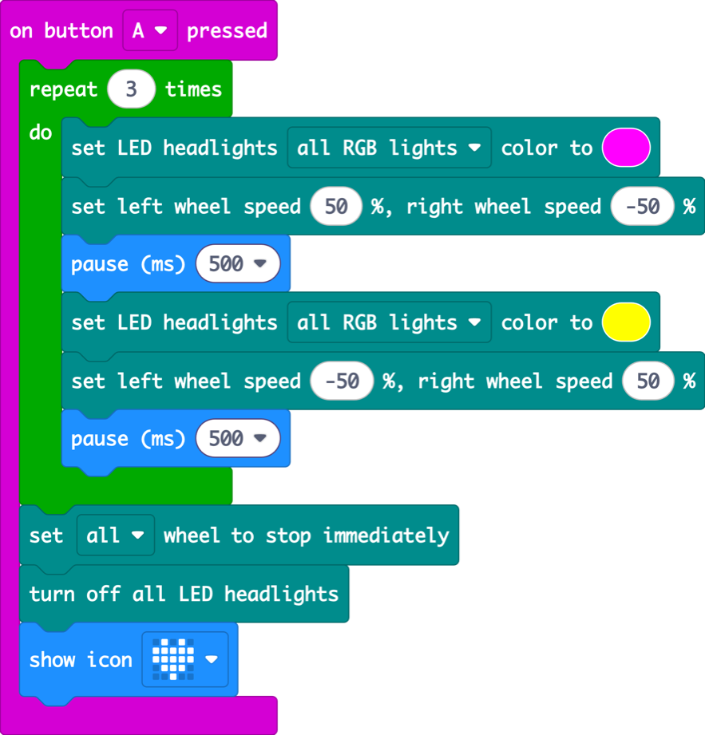
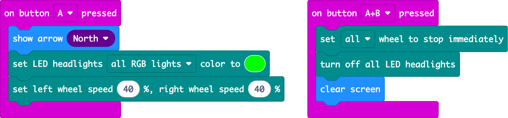
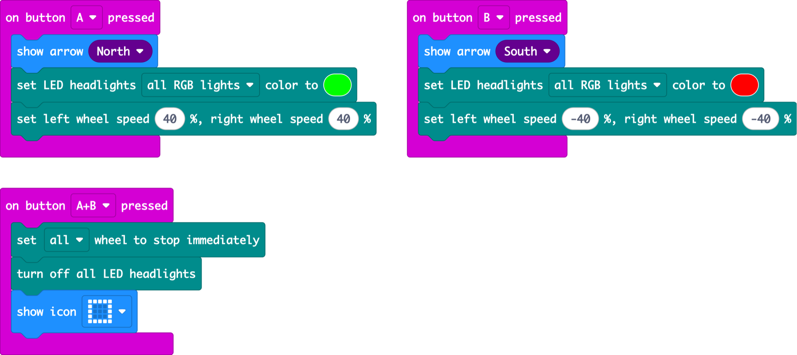

Lesson 2 · motors and lights · 60 min

The robot has been asleep in its box since the factory. Today it takes its first steps, learns to dance, and learns to drive with its buttons.

## Warm-up: remember the mood badge? (3 min)

Put the lesson 1 program on the screen. Ask: “What made the face change?” (a button press, an **event**). Today the same buttons will make the robot drive. Pupils start a **new project**, so they add the Cutebot Pro extension again (remind them of the steps from 1.3).


<details>
<summary>Copy the code for this picture (paste into MakeCode JavaScript view)</summary>

```ts
input.onButtonPressed(Button.A, function () {
    basic.showIcon(IconNames.Happy)
    CutebotPro.colorLight(CutebotProRGBLight.RGBA, 0x00ff00)
})
input.onButtonPressed(Button.B, function () {
    basic.showIcon(IconNames.Sad)
    CutebotPro.colorLight(CutebotProRGBLight.RGBA, 0x0000ff)
})
```

</details>

---

## 2.1 First steps

_18 min · wheel speed, pause, stop_

### Hook (2 min)

> **Say:** “This robot has never moved in its whole life. It doesn’t have legs. It has two wheels, and it has a clock. If I tell the wheels ‘go’ and then count to one... how far will it go?”

> **Ask:** Hands up: how far will it go in one second? Write three guesses on the board.

### Demo (6 min)

1. Drag in **on button A pressed** from Input (just like lesson 1).
2. From Cutebot Pro, add **set LED headlights** and pick green.
3. Add **set left wheel speed 50 %, right wheel speed 50 %**. Explain: 100 is full speed, 0 is stopped.
4. Add **pause 1000 ms** from Basic. “1000 milliseconds is one second.”
5. Add **stop immediately** and **turn off all LED headlights**.
6. Run it on the floor. Measure the distance with a ruler and compare with the guesses.



<details>
<summary>Copy the code for this picture (paste into MakeCode JavaScript view)</summary>

```ts
input.onButtonPressed(Button.A, function () {
    CutebotPro.colorLight(CutebotProRGBLight.RGBA, 0x00ff00)
    CutebotPro.pwmCruiseControl(50, 50)
    basic.pause(1000)
    CutebotPro.stopImmediately(CutebotProMotors.ALL)
    CutebotPro.turnOffAllHeadlights()
})
```

</details>

Key point: **without the stop block the robot never stops.** The wheels keep doing the last thing you told them. Try removing it (on the floor!) to prove it.

### Build (10 min)

#### Challenge

Make your robot take one step forward with green lights, then one step back with red lights, then smile.

- Hint: to go backwards, use a minus speed: **−50**.
- Does it come back to exactly the same place?

#### Blocks you’ll need

-  Basic **(new)**

-  Cutebot Pro

-  Cutebot Pro **(new)**

-  Input

-  Cutebot Pro **(new)**

-  Basic

-  Cutebot Pro

Tell them to remember the colours: **green means forward, red means backward**. They come back in the final project.

**Solution**



<details>
<summary>Copy the code for this picture (paste into MakeCode JavaScript view)</summary>

```ts
input.onButtonPressed(Button.A, function () {
    CutebotPro.colorLight(CutebotProRGBLight.RGBA, 0x00ff00)
    CutebotPro.pwmCruiseControl(50, 50)
    basic.pause(1000)
    CutebotPro.colorLight(CutebotProRGBLight.RGBA, 0xff0000)
    CutebotPro.pwmCruiseControl(-50, -50)
    basic.pause(1000)
    CutebotPro.stopImmediately(CutebotProMotors.ALL)
    CutebotPro.turnOffAllHeadlights()
    basic.showIcon(IconNames.Happy)
})
```

</details>

#### Watch out for

- Very low speeds may not be enough to turn the wheels. Start at 30 % or more.
- It doesn't come back to the same spot: the wheels slip a little. That’s normal and worth a chat.
- Pupils put the minus sign on only one wheel and the robot spins. Save that for 2.2!

#### Fast finishers

- Predict, then test: how far does it go in 2000 ms? At 100 %?
- Make it stop exactly on the parking line.

---

## 2.2 Dance party

_18 min · turning, repeat loop_

### Hook (2 min)

> **Say:** “Our robot just got invited to a dance-off. Problem: it only knows ‘forward’ and ‘backward’. Let’s teach it to spin.”

> **Ask:** Make two fists on the table, they’re the wheels. Both roll forward: we go straight. What happens if one fist goes forward and the other goes backward?

### Demo (6 min)

1. Set the **left wheel to 50** and the **right wheel to −50**. The robot spins on the spot.
2. Show that each headlight can have its own colour: pick **left RGB** and **right RGB** in the dropdown.
3. Ask: “Which way will it spin if I swap the numbers?” Run it to check.



<details>
<summary>Copy the code for this picture (paste into MakeCode JavaScript view)</summary>

```ts
input.onButtonPressed(Button.A, function () {
    CutebotPro.colorLight(CutebotProRGBLight.RGBL, 0xff00ff)
    CutebotPro.colorLight(CutebotProRGBLight.RGBR, 0x00ffff)
    CutebotPro.pwmCruiseControl(50, -50)
    basic.pause(1000)
    CutebotPro.stopImmediately(CutebotProMotors.ALL)
})
```

</details>

### Build (10 min)

#### Challenge

Choreograph a dance: spin one way, then the other way, three times in a row. Change the headlight colours on every move, and finish with a heart.

- New block: **repeat 4 times** from Loops. Change it to 3.
- Moves inside the repeat happen again and again. Moves after it happen once.

#### Blocks you’ll need

-  Cutebot Pro

-  Basic

-  Loops **(new)**

-  Cutebot Pro

-  Cutebot Pro

-  Basic

-  Input

-  Cutebot Pro

**Solution**



<details>
<summary>Copy the code for this picture (paste into MakeCode JavaScript view)</summary>

```ts
input.onButtonPressed(Button.A, function () {
    for (let index = 0; index < 3; index++) {
        CutebotPro.colorLight(CutebotProRGBLight.RGBA, 0xff00ff)
        CutebotPro.pwmCruiseControl(50, -50)
        basic.pause(500)
        CutebotPro.colorLight(CutebotProRGBLight.RGBA, 0xffff00)
        CutebotPro.pwmCruiseControl(-50, 50)
        basic.pause(500)
    }
    CutebotPro.stopImmediately(CutebotProMotors.ALL)
    CutebotPro.turnOffAllHeadlights()
    basic.showIcon(IconNames.Heart)
})
```

</details>

#### Watch out for

- The stop block ends up inside the repeat, so the dance stutters. Ask “what should happen only once?”
- Pauses of 100 ms are too fast to see. Use 300 ms or more.

#### Fast finishers

- With a micro:bit V2, add **play melody** from Music before the repeat.
- Add a little hop: a short forward and back between spins.
- Dance-off: two robots side by side, same code, who stays in sync?

---

## 2.3 Button driver

_18 min · events, arrows_

### Hook (2 min)

> **Say:** “Until now the robot did a dance we planned in advance. Now **you** are the driver. In lesson 1, button A meant ‘happy’. What should button A mean for a car?”

> **Ask:** If we press A and the robot starts driving, when will it stop?

### Demo (6 min)

1. Button A: north arrow, green lights, both wheels 40 %. **No pause, no stop.**
2. Button A+B: stop, lights off, clear the screen.
3. Press A and walk away. The robot keeps going: “the motors remember the last order.” The buttons ride on the robot, so the driver walks alongside to press A+B.



<details>
<summary>Copy the code for this picture (paste into MakeCode JavaScript view)</summary>

```ts
input.onButtonPressed(Button.A, function () {
    basic.showArrow(ArrowNames.North)
    CutebotPro.colorLight(CutebotProRGBLight.RGBA, 0x00ff00)
    CutebotPro.pwmCruiseControl(40, 40)
})
input.onButtonPressed(Button.AB, function () {
    CutebotPro.stopImmediately(CutebotProMotors.ALL)
    CutebotPro.turnOffAllHeadlights()
    basic.clearScreen()
})
```

</details>

### Build (10 min)

#### Challenge

Finish your button driver: button B drives backwards with red lights and a south arrow. A+B stops and shows a square.

- Parking game: start at the start line, park as close as you can to the parking line. Closest pair wins.

#### Blocks you’ll need

-  Cutebot Pro

-  Basic **(new)**

-  Cutebot Pro

-  Input

-  Cutebot Pro

-  Basic

-  Cutebot Pro

**Solution**



<details>
<summary>Copy the code for this picture (paste into MakeCode JavaScript view)</summary>

```ts
input.onButtonPressed(Button.A, function () {
    basic.showArrow(ArrowNames.North)
    CutebotPro.colorLight(CutebotProRGBLight.RGBA, 0x00ff00)
    CutebotPro.pwmCruiseControl(40, 40)
})
input.onButtonPressed(Button.B, function () {
    basic.showArrow(ArrowNames.South)
    CutebotPro.colorLight(CutebotProRGBLight.RGBA, 0xff0000)
    CutebotPro.pwmCruiseControl(-40, -40)
})
input.onButtonPressed(Button.AB, function () {
    CutebotPro.stopImmediately(CutebotProMotors.ALL)
    CutebotPro.turnOffAllHeadlights()
    basic.showIcon(IconNames.Square)
})
```

</details>

#### Watch out for

- Pressing A+B one after the other runs A or B first. Press both at exactly the same time.
- The robot is plugged into the computer and driving off the desk. Unplug before testing!

#### Fast finishers

- micro:bit V2: use **on logo pressed** (Input) to spin on the spot.
- Use **on shake** to flash the headlights like a horn.

### Wrap (3 min)

> **Say:** “Today you drove the robot. But it’s blind: it would drive straight into a wall. Next lesson, the robot gets its senses.”

---
[← Lesson 1](/exercises/makecode/robotics/cutebot/lesson-1/) [Lesson 3: The robot can see →](/exercises/makecode/robotics/cutebot/lesson-3/)
