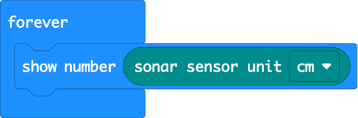
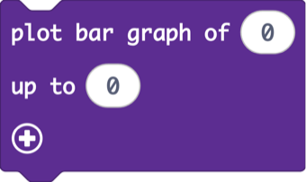
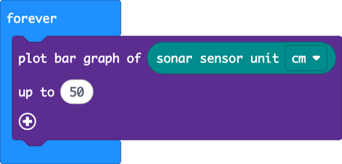
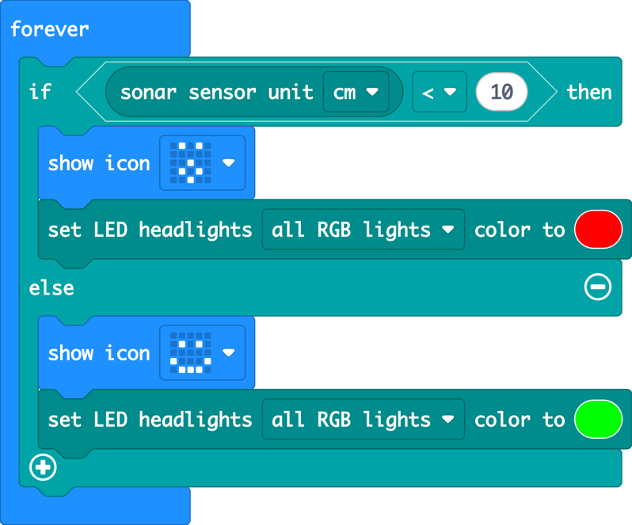
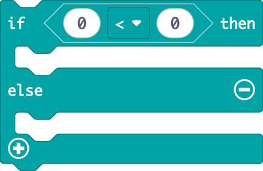
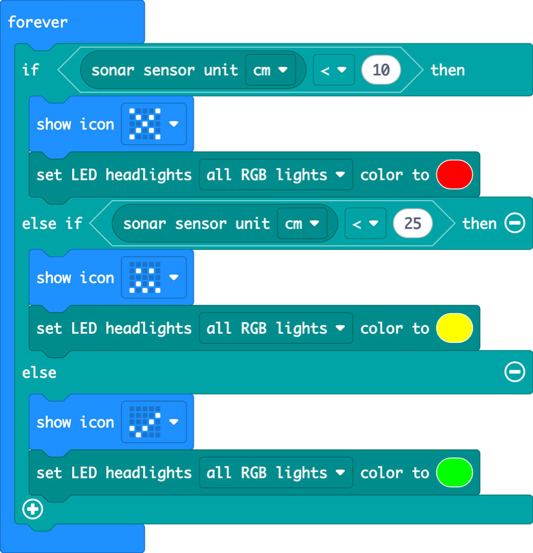
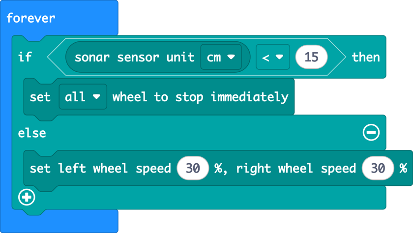
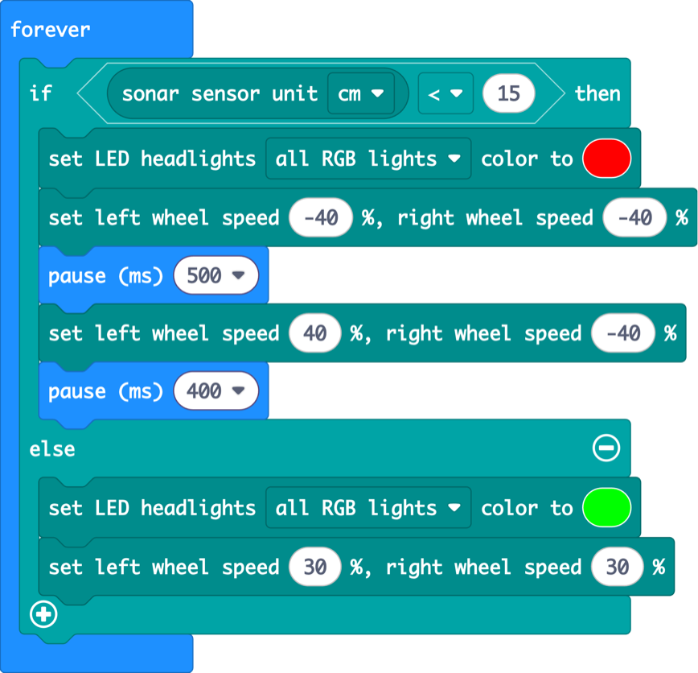

Lesson 3 · sensors and decisions · 60 min

Those two round “eyes” on the front aren’t eyes at all. They work like a bat’s ears. Today the robot measures distance and starts making its own decisions.

## Warm-up: drive with the buttons from lesson 2 (3 min)

Pairs download their lesson 2 button driver and drive their robot for a few minutes. Ask: “Your robot drove into the wall last time. Why didn’t it stop by itself?” It can’t see yet, and that’s today’s lesson.

---

## 3.1 Bat ears

_17 min · sonar sensor, forever_

### Hook (2 min)

> **Say:** “Bats fly in total darkness without crashing. They shout and listen for the echo. Our robot does exactly the same. One circle is a tiny speaker that shouts a sound too high for us to hear. The other is a microphone that listens for the echo.”

> **Ask:** If the echo comes back really fast, is the wall close or far?

### Demo (6 min)

1. Introduce **forever**: “it runs again and again, as long as the robot is on.” A sensor needs to be checked all the time, not just once.
2. Put **show number** inside, and drop the round **sonar sensor unit cm** block into its hole. Round blocks are **values**: they fit into holes.
3. Move your hand in front of the robot and watch the number change.



<details>
<summary>Copy the code for this picture (paste into MakeCode JavaScript view)</summary>

```ts
basic.forever(function () {
    basic.showNumber(CutebotPro.ultrasonic(SonarUnit.Centimeters))
})
```

</details>

**Distance detective (3 min game):** call out a distance (“17 cm!”). Pairs race to hold a hand at exactly that distance, then check with a ruler.

### Build (9 min)

#### Challenge

Turn the screen into a distance meter: the further away your hand is, the more LEDs light up.

- New block: **plot bar graph of … up to …** (in Led). Put the sonar block in the first hole and 50 in the second.

#### Blocks you’ll need

-  Cutebot Pro **(new)**

-  Basic

-  Led **(new)**

**Solution**



<details>
<summary>Copy the code for this picture (paste into MakeCode JavaScript view)</summary>

```ts
basic.forever(function () {
    led.plotBarGraph(CutebotPro.ultrasonic(SonarUnit.Centimeters), 50)
})
```

</details>

#### Watch out for

- Soft things (jumpers, cushions) swallow the sound and give strange numbers. Flat, hard surfaces work best.
- The sensor shows **0** when it hears no echo at all (nothing in front, or too far). Remember this for lesson 4!

#### Fast finishers

- Change “up to 50” to 20. What changes?
- What is the closest distance the sensor can measure? The furthest?

---

## 3.2 Parking sensor

_19 min · if / else, else if, comparing numbers_

### Hook (2 min)

> **Say:** “When a car reverses into a parking space, it beeps faster and faster as it gets close to the wall. Real cars use the very same kind of sensor that’s on your robot.”

> **Ask:** How does the car decide when to beep? What question is it asking itself, over and over?

Steer them to: **“Is the wall closer than …?”** That question is an **if**.

### Demo (7 min)

1. From Logic, take **if … then … else**. Put it in a forever.
2. From Logic, take the **0 &lt; 0** comparison. Put the sonar block on the left and type 10 on the right.
3. If closer than 10: surprised face, red lights. Else: happy face, green lights.
4. Read the program out loud as a sentence. Pupils love hearing that code can be read like normal words.



<details>
<summary>Copy the code for this picture (paste into MakeCode JavaScript view)</summary>

```ts
basic.forever(function () {
    if (CutebotPro.ultrasonic(SonarUnit.Centimeters) < 10) {
        basic.showIcon(IconNames.Surprised)
        CutebotPro.colorLight(CutebotProRGBLight.RGBA, 0xff0000)
    } else {
        basic.showIcon(IconNames.Happy)
        CutebotPro.colorLight(CutebotProRGBLight.RGBA, 0x00ff00)
    }
})
```

</details>

### Build (10 min)

#### Challenge

Make a three-zone parking sensor: red ✗ when very close (under 10 cm), yellow when getting close (under 25 cm), and green ✓ when the road is clear.

- Click the **+** at the bottom of the if block to add an **else if**.

#### Blocks you’ll need

-  Cutebot Pro

-  Logic **(new)**

-  Cutebot Pro

-  Basic

-  Basic

**Solution**



<details>
<summary>Copy the code for this picture (paste into MakeCode JavaScript view)</summary>

```ts
basic.forever(function () {
    if (CutebotPro.ultrasonic(SonarUnit.Centimeters) < 10) {
        basic.showIcon(IconNames.No)
        CutebotPro.colorLight(CutebotProRGBLight.RGBA, 0xff0000)
    } else if (CutebotPro.ultrasonic(SonarUnit.Centimeters) < 25) {
        basic.showIcon(IconNames.Confused)
        CutebotPro.colorLight(CutebotProRGBLight.RGBA, 0xffff00)
    } else {
        basic.showIcon(IconNames.Yes)
        CutebotPro.colorLight(CutebotProRGBLight.RGBA, 0x00ff00)
    }
})
```

</details>

#### Watch out for

- **Order matters.** If pupils check “under 25” first, the red zone never happens, because 5 is also under 25! Great 2-minute class discussion.
- The sonar block is used twice. That’s fine today. In lesson 4 we fix it with a variable.

#### Fast finishers

- micro:bit V2: add **play tone** (Music) in the red zone to beep like a real car.
- Add a fourth zone with a new colour.

---

## 3.3 Mars rover

_18 min · sensing + driving, obstacle avoiding_

### Hook (2 min)

> **Say:** “A rover on Mars has no driver. A radio message from Earth takes between 4 and 24 minutes to arrive, which is way too slow to shout ‘STOP!’. So the rover has to look and decide by itself.”

> **Ask:** What two things should the rover do over and over again? (Look. Decide.)

### Demo (6 min)

1. Reuse the if/else from 3.2. This time the decision controls the wheels, not the screen.
2. Closer than 15 cm: stop. Otherwise: drive at 30 %.
3. Hold a book in front of the robot, then pull it away slowly. The robot follows the book and stops. (This is a sneak peek of lesson 4, so don’t tell them!)



<details>
<summary>Copy the code for this picture (paste into MakeCode JavaScript view)</summary>

```ts
basic.forever(function () {
    if (CutebotPro.ultrasonic(SonarUnit.Centimeters) < 15) {
        CutebotPro.stopImmediately(CutebotProMotors.ALL)
    } else {
        CutebotPro.pwmCruiseControl(30, 30)
    }
})
```

</details>

### Build (10 min)

#### Challenge

Build a Mars rover that explores a maze of books. When something is close: red lights, back up, turn, and carry on exploring with green lights.

- Build a little maze on the floor with books and bags.

#### Blocks you’ll need

-  Cutebot Pro

-  Cutebot Pro

-  Basic

-  Basic

-  Logic

-  Cutebot Pro

**Solution**



<details>
<summary>Copy the code for this picture (paste into MakeCode JavaScript view)</summary>

```ts
basic.forever(function () {
    if (CutebotPro.ultrasonic(SonarUnit.Centimeters) < 15) {
        CutebotPro.colorLight(CutebotProRGBLight.RGBA, 0xff0000)
        CutebotPro.pwmCruiseControl(-40, -40)
        basic.pause(500)
        CutebotPro.pwmCruiseControl(40, -40)
        basic.pause(400)
    } else {
        CutebotPro.colorLight(CutebotProRGBLight.RGBA, 0x00ff00)
        CutebotPro.pwmCruiseControl(30, 30)
    }
})
```

</details>

#### Watch out for

- **Don’t use show icon in a driving loop.** Each picture takes about half a second, and the robot is blind and still driving meanwhile. Use the headlights to show what it’s doing.
- The robot spins forever: the turn pause is too long or the speed too high.

#### Fast finishers

- Use **pick random** (Math) to sometimes turn left, sometimes right.
- Race: who escapes the maze fastest without touching a wall?

### Wrap (3 min)

> **Say:** “Your rover runs _away_ from things. Next lesson, it will do the opposite: it will follow you like a puppy, and stop before it bumps into you.”

---
[← Lesson 2](/exercises/makecode/robotics/cutebot/lesson-2/) [Lesson 4: Follow me! →](/exercises/makecode/robotics/cutebot/lesson-4/)
