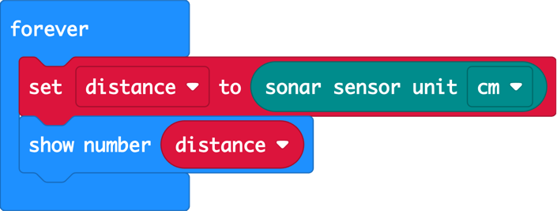
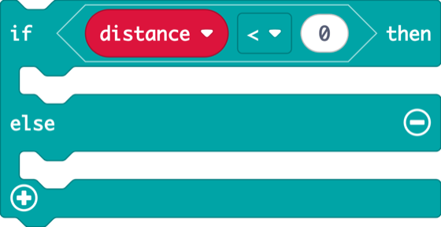
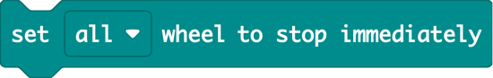
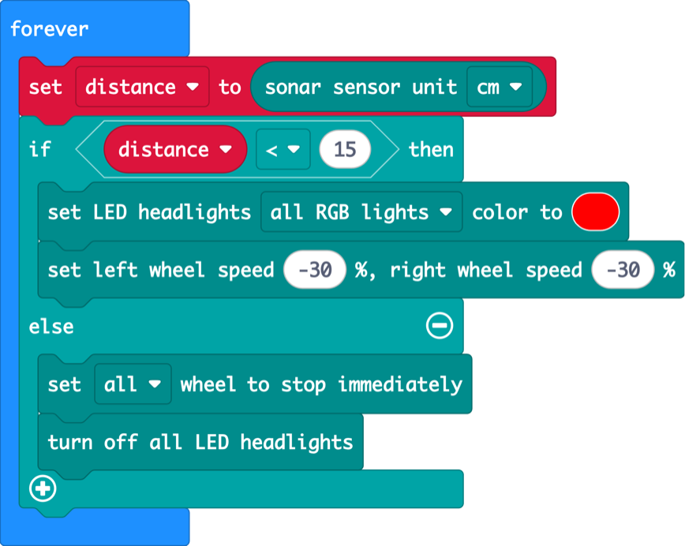
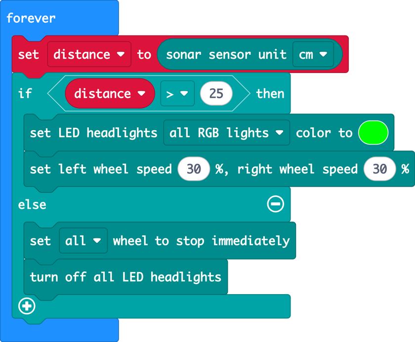
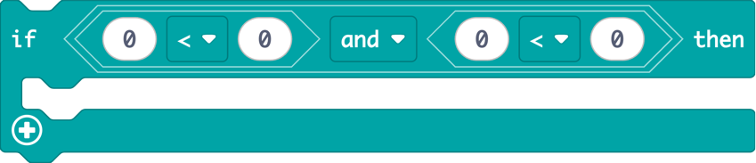
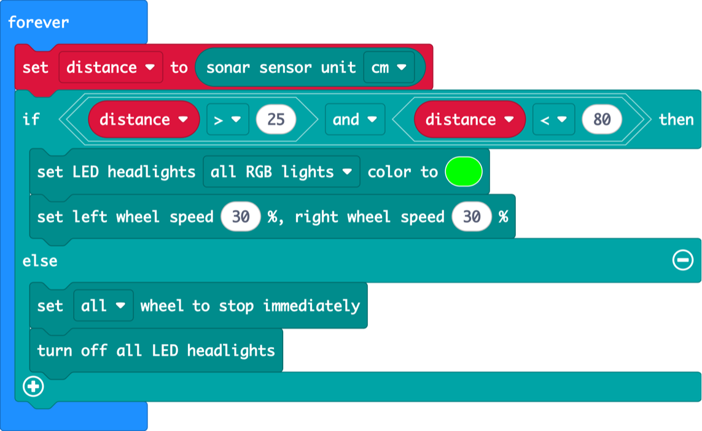
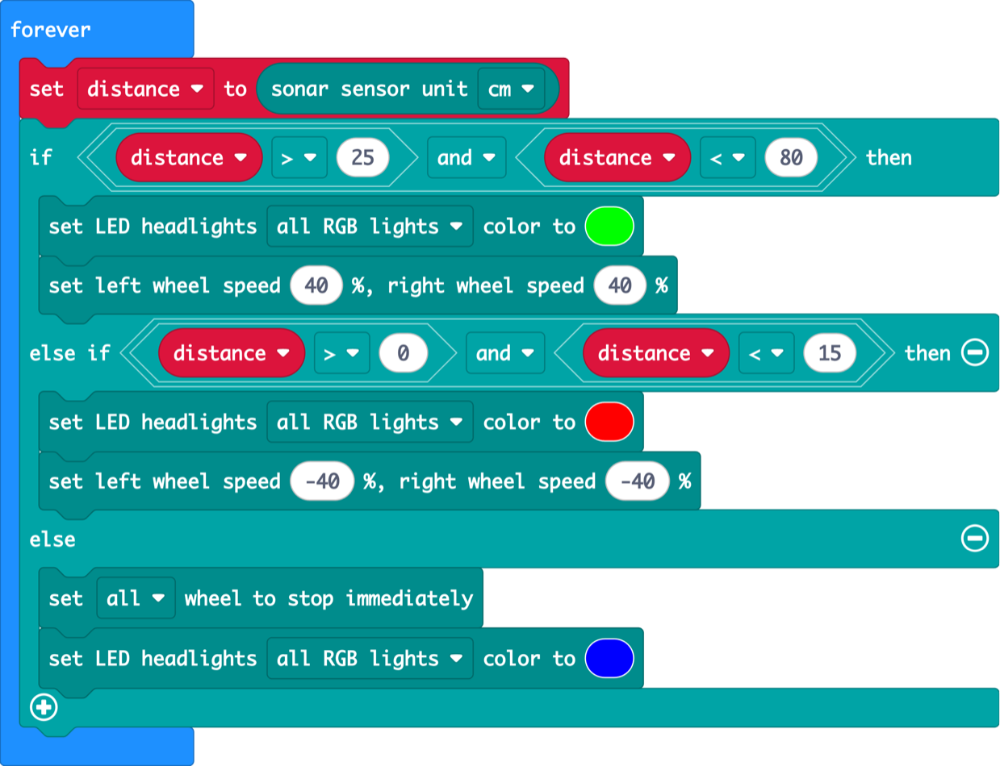
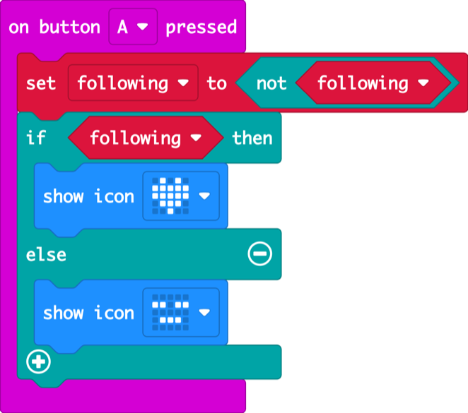
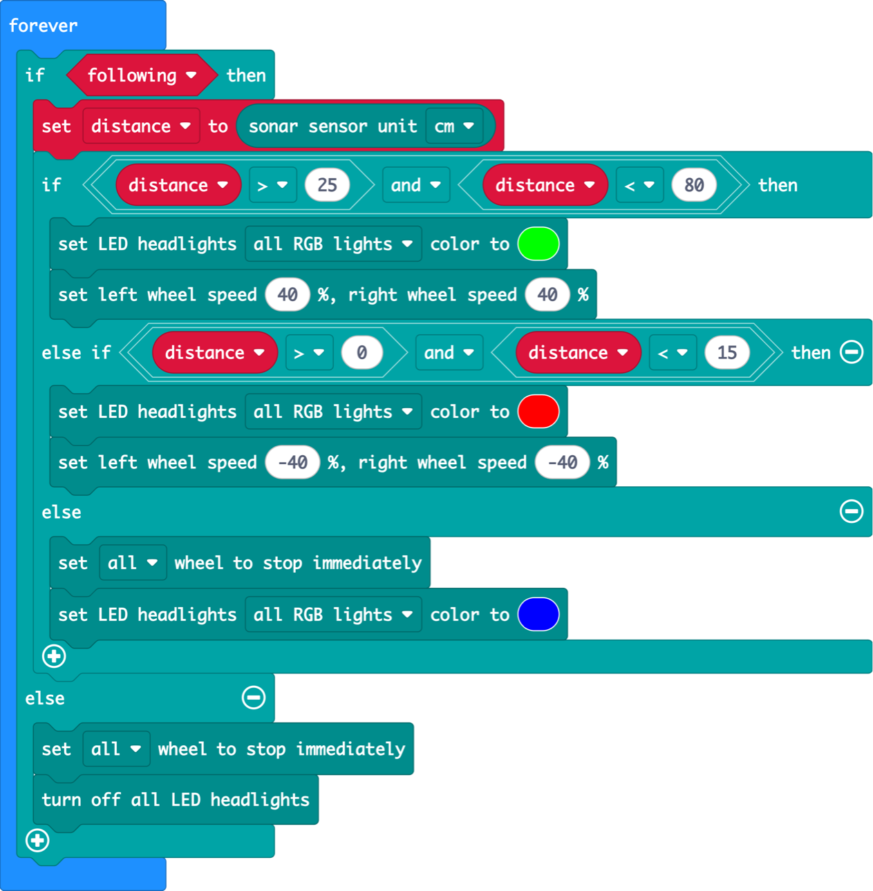

Lesson 4 · variables and the final project · 60 min

First a shy robot that backs away, then a curious puppy that comes closer. Put them together and you get a robot that follows you and stops at just the right distance.

## Warm-up: the human robot (5 min, no computers)

In pairs. One pupil is the robot and holds their hands out flat in front of them: that’s the sonar. The other holds up a palm as the target and walks around slowly. Rules on the board:

- **Far away** → robot steps **forward** (say “green!”)
- **Too close** → robot steps **back** (say “red!”)
- **Just right** → robot **freezes**

Then: **“Those three rules are the whole final program. Let’s teach them to the Cutebot, one rule at a time.”**

---

## 4.1 Shy robot

_13 min · variables, backing away_

### Hook (2 min)

> **Say:** “Our robot is shy. If you come too close, it backs away. But first it needs a memory. Right now it measures and forgets straight away. In the parking sensor we had to measure twice!”

> **Ask:** When you measure something and want to remember it, what do you do? (Write it down. A variable is the robot’s notepad.)

### Demo (4 min)

1. Variables → **Make a Variable…** → name it `distance`.
2. At the top of forever: **set distance to** sonar. Then **show number distance**.
3. Picture it as a box with a label: every time round the loop, we throw out the old number and put the new one in.



<details>
<summary>Copy the code for this picture (paste into MakeCode JavaScript view)</summary>

```ts
let distance = 0
basic.forever(function () {
    distance = CutebotPro.ultrasonic(SonarUnit.Centimeters)
    basic.showNumber(distance)
})
```

</details>

### Build (7 min)

#### Challenge

Make the robot shy: when you are closer than 15 cm, it backs away with red lights. Otherwise it stays still with its lights off.

- Use your `distance` variable in the if, not the sonar block.

#### Blocks you’ll need

-  Logic · Variables **(new)**

-  Cutebot Pro

-  Cutebot Pro

-  Variables **(new)**

-  Cutebot Pro

-  Basic

-  Cutebot Pro

-  Cutebot Pro

**Solution**



<details>
<summary>Copy the code for this picture (paste into MakeCode JavaScript view)</summary>

```ts
let distance = 0
basic.forever(function () {
    distance = CutebotPro.ultrasonic(SonarUnit.Centimeters)
    if (distance < 15) {
        CutebotPro.colorLight(CutebotProRGBLight.RGBA, 0xff0000)
        CutebotPro.pwmCruiseControl(-30, -30)
    } else {
        CutebotPro.stopImmediately(CutebotProMotors.ALL)
        CutebotPro.turnOffAllHeadlights()
    }
})
```

</details>

#### Watch out for

- **set distance** placed in _on start_ only measures once. It must be inside forever, at the top.
- The robot backs away with nothing in front: that’s the **0** reading from 3.1 (no echo counts as 0, and 0 is under 15). Keep this for the final project.

#### Fast finishers

- Make it extra shy: 30 cm.
- Shy _and_ polite: show a surprised face when it backs off (but remember the screen is slow!).

---

## 4.2 Curious puppy

_13 min · “and”, ranges_

### Hook (2 min)

> **Say:** “Now the opposite: a curious puppy. When you walk away, it trots after you. But a good puppy doesn’t chase the wall on the other side of the room.”

### Demo (4 min)

1. Flip the shy robot: if distance is **more than 25**, go forward with green lights.
2. Run it in an open space, pointing at a far wall. Oops: it drives all the way to the wall.



<details>
<summary>Copy the code for this picture (paste into MakeCode JavaScript view)</summary>

```ts
let distance = 0
basic.forever(function () {
    distance = CutebotPro.ultrasonic(SonarUnit.Centimeters)
    if (distance > 25) {
        CutebotPro.colorLight(CutebotProRGBLight.RGBA, 0x00ff00)
        CutebotPro.pwmCruiseControl(30, 30)
    } else {
        CutebotPro.stopImmediately(CutebotProMotors.ALL)
        CutebotPro.turnOffAllHeadlights()
    }
})
```

</details>

> **Ask:** How do we tell the robot “far, but not _too_ far”?

### Build (7 min)

#### Challenge

Teach the puppy to only follow you when you are more than 25 cm away **and** less than 80 cm away.

- New block: **and** from Logic. Each side holds one comparison.

#### Blocks you’ll need

-  Cutebot Pro

-  Logic **(new)**

-  Cutebot Pro

-  Variables

-  Basic

-  Cutebot Pro

-  Logic · Variables

-  Cutebot Pro

-  Cutebot Pro

**Solution**



<details>
<summary>Copy the code for this picture (paste into MakeCode JavaScript view)</summary>

```ts
let distance = 0
basic.forever(function () {
    distance = CutebotPro.ultrasonic(SonarUnit.Centimeters)
    if (distance > 25 && distance < 80) {
        CutebotPro.colorLight(CutebotProRGBLight.RGBA, 0x00ff00)
        CutebotPro.pwmCruiseControl(30, 30)
    } else {
        CutebotPro.stopImmediately(CutebotProMotors.ALL)
        CutebotPro.turnOffAllHeadlights()
    }
})
```

</details>

#### Watch out for

- Pupils use **or** instead of **and**: then everything counts and the puppy chases walls again.
- &lt; and > mixed up. Read it aloud: “distance is greater than 25”.

#### Fast finishers

- Hold a notebook and walk backwards slowly. Can you lead the puppy across the room?
- Start the final project early!

---

## Final Follow me, Cutebot

_24 min · everything together_

### Hook (2 min)

> **Say:** “You built a shy robot and a curious puppy. A shy puppy that is also curious... is a robot that follows you and keeps a safe distance. Just like the human robot game. Let’s build it.”

### Plan it (4 min)

Draw this on the board. Every distance belongs to exactly one zone:

| Sonar reading | What the robot does | Lights |
| --- | --- | --- |
| 0 (nothing seen) | Stop | Blue |
| 1 to 15 cm | Back up | Red |
| 15 to 25 cm | Stay | Blue |
| 25 to 80 cm | Follow | Green |
| Over 80 cm (lost) | Stop | Blue |

**Why is there a “stay” zone?** Ask what happens if “follow” and “back up” used the same number, say 20 cm. The robot would shake back and forth forever (try it as a fast-finisher experiment!). The gap gives it somewhere to rest. Heating thermostats use the same trick.

### Build (18 min)

#### Final project

Program your robot to follow you. Too far: drive forward with green lights. Too close: back up with red lights. Just right, or lost: stop with blue lights.

- Test with a notebook held low, at the height of the robot’s sonar, and walk slowly.

#### Blocks you’ll need

-  Cutebot Pro

-  Logic

-  Cutebot Pro

-  Variables

-  Cutebot Pro

-  Cutebot Pro

-  Logic · Variables

-  Basic

Give hints one at a time, only when a pair is stuck:

1. Start from your Curious puppy program. It already does the green part.
2. Click **+** on the if block to add an **else if** for “too close”.
3. Copy the red blocks from your Shy robot into the else if.
4. The robot backs away from nothing? Remember the **0**: “too close” should be _more than 0 **and** less than 15_.

**Solution**



<details>
<summary>Copy the code for this picture (paste into MakeCode JavaScript view)</summary>

```ts
let distance = 0
basic.forever(function () {
    distance = CutebotPro.ultrasonic(SonarUnit.Centimeters)
    if (distance > 25 && distance < 80) {
        CutebotPro.colorLight(CutebotProRGBLight.RGBA, 0x00ff00)
        CutebotPro.pwmCruiseControl(40, 40)
    } else if (distance > 0 && distance < 15) {
        CutebotPro.colorLight(CutebotProRGBLight.RGBA, 0xff0000)
        CutebotPro.pwmCruiseControl(-40, -40)
    } else {
        CutebotPro.stopImmediately(CutebotProMotors.ALL)
        CutebotPro.colorLight(CutebotProRGBLight.RGBA, 0x0000ff)
    }
})
```

</details>

#### Watch out for

- The sonar is low and narrow: legs and loose clothes give jumpy readings. A notebook works best.
- The robot reacts late: check there is no **show icon** or **pause** inside the forever.
- High speeds (above about 60 %) overshoot and bump into the target.

#### Fast finishers

- The shaking experiment: set both numbers to 20 and watch.
- Tune it: what speed and distances feel most like a real pet?
- Sleep mode: button A switches following on and off (solution below).

**Bonus: sleep mode with button A**

A true/false variable `following` remembers whether the robot is awake. **not** flips it on every press.



<details>
<summary>Copy the code for this picture (paste into MakeCode JavaScript view)</summary>

```ts
let following = false
input.onButtonPressed(Button.A, function () {
    following = !(following)
    if (following) {
        basic.showIcon(IconNames.Heart)
    } else {
        basic.showIcon(IconNames.Asleep)
    }
})
```

</details>



<details>
<summary>Copy the code for this picture (paste into MakeCode JavaScript view)</summary>

```ts
let distance = 0
let following = false
basic.forever(function () {
    if (following) {
        distance = CutebotPro.ultrasonic(SonarUnit.Centimeters)
        if (distance > 25 && distance < 80) {
            CutebotPro.colorLight(CutebotProRGBLight.RGBA, 0x00ff00)
            CutebotPro.pwmCruiseControl(40, 40)
        } else if (distance > 0 && distance < 15) {
            CutebotPro.colorLight(CutebotProRGBLight.RGBA, 0xff0000)
            CutebotPro.pwmCruiseControl(-40, -40)
        } else {
            CutebotPro.stopImmediately(CutebotProMotors.ALL)
            CutebotPro.colorLight(CutebotProRGBLight.RGBA, 0x0000ff)
        }
    } else {
        CutebotPro.stopImmediately(CutebotProMotors.ALL)
        CutebotPro.turnOffAllHeadlights()
    }
})
```

</details>

### Parade (5 min)

Everyone puts their robot on the start line, holds a notebook in front of it, and walks slowly across the room in a line. Robots that make it to the other side join the “Follow Me hall of fame” on the board.

> **Say:** “Four lessons ago, you made a heart beat. Today your robot can see you, decide what to do and follow you. Some robots in warehouses and hospitals do exactly this, with the same idea you just built.”

---
[← Lesson 3](/exercises/makecode/robotics/cutebot/lesson-3/) [Troubleshooting →](/exercises/makecode/robotics/cutebot/troubleshooting/)
