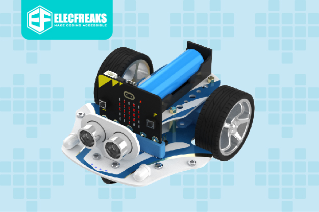

Beginner curriculum · no prior knowledge needed

## From a beating heart to a robot that follows you

Four 60-minute lessons for 12-year-olds who have never coded. You don’t need to be a coder to teach it: every step is scripted, and every solution is shown as blocks.

- [**Hello, micro:bit** — Screen, buttons, headlights](/exercises/makecode/robotics/cutebot/lesson-1/)

- [**Wake up your robot** — Motors, turning, repeat](/exercises/makecode/robotics/cutebot/lesson-2/)

- [**The robot can see** — Sonar sensor, if / else](/exercises/makecode/robotics/cutebot/lesson-3/)

- [**Follow me!** — Variables, final project](/exercises/makecode/robotics/cutebot/lesson-4/)

## Every lesson, the same rhythm

After a short warm-up, every lesson runs three rounds of the same loop, then ends with a short wrap-up.

- **Hook** 2 min · a short story or question
- **Demo** 6 min · build the example live on the projector
- **Build** 10 min · pairs take on the challenge

## Before lesson 1

### Kit per pair

_Image: ELECFREAKS, from [pxt-cutebot-pro](https://github.com/elecfreaks/pxt-cutebot-pro) (MIT License, © 2022 ELECFREAKS)._

- [Cutebot Pro](https://www.elecfreaks.com/) by ELECFREAKS, charged (its battery also powers the micro:bit)
- [BBC micro:bit](https://microbit.org) (V2 recommended) and a USB cable
- A computer with [makecode.microbit.org](https://makecode.microbit.org) open
- 2 m of clear floor. Later: books (lesson 3), a notebook (lesson 4)

### Robot rules (read aloud)

- **Robots live on the floor.**
- Driving programs start from **button A**.
- Whoever presses A catches the robot.

### Robot blocks

**Extensions** → search `cutebot pro` → pick **Cutebot Pro** by ELECFREAKS. Needed once per new project.

Every block picture has a copy button in its corner. After adding the Cutebot Pro extension, paste the code into MakeCode’s **JavaScript** view, then switch back to **Blocks**: the same blocks appear.

## Words pupils will learn

- **Block**: One instruction. Blocks snap together. _(Lesson 1)_
- **Simulator**: The pretend micro:bit on screen. _(Lesson 1)_
- **Loop**: Blocks that repeat again and again. _(Lesson 1)_
- **Event**: Something, like a button press, that starts code. _(Lesson 1)_
- **Motor**: Turns a wheel, from −100 (back) to 100 (forward). _(Lesson 2)_
- **Sensor**: The robot’s sense. The sonar measures distance. _(Lesson 3)_
- **Condition**: A yes/no question that decides what runs. _(Lesson 3)_
- **Variable**: A labelled box that remembers a value. _(Lesson 4)_
