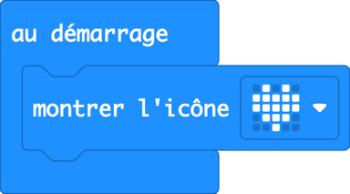
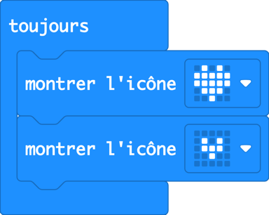
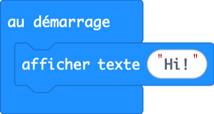
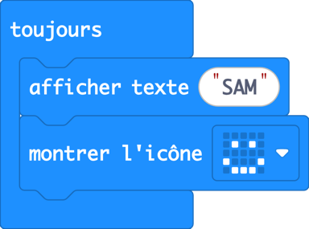
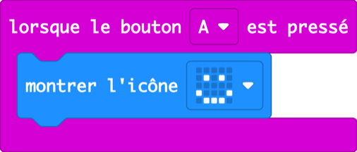
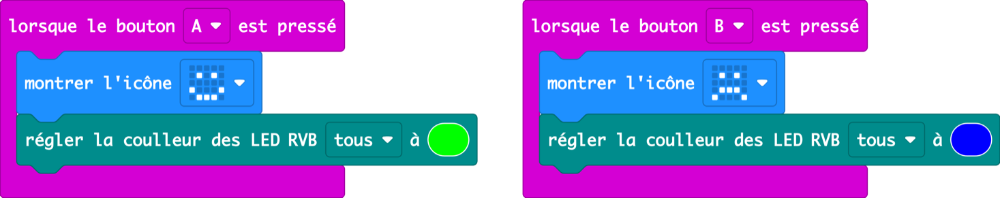

Leçon 1 · premier contact, aucune expérience requise · 60 min

Les élèves découvrent un tout petit ordinateur, écrivent leur tout premier programme et finissent par fabriquer un badge qui montre leur humeur, avec les phares du robot qui changent de couleur.

## Intro : découvrir le micro:bit et MakeCode

_10 min · 3 min sans ordinateur_

### Accroche (3 min)

> **Dites :** « Levez la main si vous pensez qu’il y a un ordinateur dans un téléphone. Dans une voiture ? Dans une machine à laver ? Dans une carte d’anniversaire qui joue de la musique ? Les ordinateurs se cachent partout, et aujourd’hui vous avez le vôtre. Il est plus petit qu’une carte bancaire. »

Distribuez les micro:bits. Les élèves cherchent : les **25 lumières rouges** (l’écran LED), le **bouton A** et le **bouton B**, et la prise USB. Dites-leur que rien ne casse s’ils le touchent.

### Visite (7 min)

Au vidéoprojecteur, montrez les quatre zones de MakeCode. Les élèves vous imitent sur leur ordinateur.

1. Ouvrez [makecode.microbit.org](https://makecode.microbit.org). Si les menus sont en anglais : ⚙ → **Language** → **Français**.
2. Cliquez sur **Nouveau projet** → tapez un nom → **Créer**.
3. **Les catégories** (colonne du milieu) : Base, Entrées, Musique… Chaque catégorie contient des blocs d’une même couleur.
4. **L’espace de travail** (la grande zone blanche) : c’est là qu’on construit. On y glisse un bloc ; on le ramène vers les catégories pour le supprimer.
5. **Le simulateur** (à gauche) : un faux micro:bit. Il exécute le code tout de suite, sans avoir besoin du vrai.
6. **Télécharger** (en bas à gauche) : envoie le programme au vrai micro:bit par le câble USB. La première fois, cliquez sur **⋯ → Connecter l’appareil** et suivez les étapes (cela fonctionne dans Chrome et Edge ; dans les autres navigateurs, glissez le fichier téléchargé sur le lecteur **MICROBIT**).

Dites-le clairement : **on ne peut rien casser en essayant.** Le bouton Annuler (la flèche courbe) permet d’annuler n’importe quelle erreur.

---

## 1.1 Battement de cœur

_14 min · premier bloc, boucle toujours_

### Accroche (2 min)

> **Dites :** « Posez deux doigts sur votre cou. Vous sentez ? Votre cœur bat environ 80 fois par minute, toute la journée, sans que vous y pensiez. Aujourd’hui, on donne un cœur au micro:bit. »

> **Demandez :** Que fait un cœur, encore et encore ? (Il devient grand, puis petit, puis grand…)

### Démo (5 min)

1. Un nouveau projet contient déjà **au démarrage** et **toujours**. Le bloc **au démarrage** s’exécute une fois, quand le micro:bit s’allume.
2. Ouvrez la catégorie **Base** et glissez **montrer l’icône** dans **au démarrage**. Il s’emboîte avec un clic.
3. Cliquez sur la petite image et choisissez le cœur. Regardez : le simulateur l’affiche tout de suite.
4. Téléchargez-le ensemble sur le vrai micro:bit. C’est le premier programme de tout le monde !



<details>
<summary>Copier le code de cette image (à coller dans la vue JavaScript de MakeCode)</summary>

```ts
basic.showIcon(IconNames.Heart)
```

</details>

### Pratique (7 min)

#### Défi

Faites battre le cœur : grand cœur, petit cœur, grand cœur, petit cœur… pour toujours.

- Utilisez le bloc **toujours** au lieu du bloc **au démarrage** : il se répète sans s’arrêter.
- Il faut deux blocs **montrer l’icône**.

#### Les blocs dont vous aurez besoin

-  Base

-  Base **(nouveau)**

**Solution**



<details>
<summary>Copier le code de cette image (à coller dans la vue JavaScript de MakeCode)</summary>

```ts
basic.forever(function () {
    basic.showIcon(IconNames.Heart)
    basic.showIcon(IconNames.SmallHeart)
})
```

</details>

#### Attention à

- Le bloc flotte tout seul sans être emboîté. Un bloc flottant est grisé et ne s’exécute pas.
- Les deux blocs montrent le même cœur : rien ne semble bouger.
- Le téléchargement « ne fait rien » : vérifiez que le câble est branché et que l’appareil est bien connecté.

#### Pour aller plus loin

- Ajoutez un bloc **pause** (Base) pour un cœur lent et endormi.
- Faites un cœur qui s’emballe : qu’est-ce qui l’accélère ?

---

## 1.2 Badge prénom

_14 min · texte, ordre des blocs_

### Accroche (2 min)

> **Dites :** « Dans les conférences, les gens portent un badge avec leur prénom. Le nôtre sera le seul badge de l’école qui défile ! »

> **Demandez :** L’écran ne fait que 5 lumières de large. Comment afficher un long prénom ?

### Démo (5 min)

1. Dans **Base**, glissez **afficher texte** dans **au démarrage**.
2. Cliquez sur le mot à l’intérieur et tapez **Hi!**. Regardez-le défiler sur le simulateur, une lettre à la fois.
3. Faites remarquer : le programme s’exécute **de haut en bas**. L’ordre des blocs, c’est l’ordre des actions.



<details>
<summary>Copier le code de cette image (à coller dans la vue JavaScript de MakeCode)</summary>

```ts
basic.showString("Hi!")
```

</details>

### Pratique (7 min)

#### Défi

Fabriquez un badge qui fait défiler votre prénom, puis montre un visage souriant, encore et encore.

- Quel bloc se répète pour toujours ? Vous l’avez utilisé pour le cœur.

#### Les blocs dont vous aurez besoin

-  Base

-  Base **(nouveau)**

-  Base

**Solution**



<details>
<summary>Copier le code de cette image (à coller dans la vue JavaScript de MakeCode)</summary>

```ts
basic.forever(function () {
    basic.showString("SAM")
    basic.showIcon(IconNames.Happy)
})
```

</details>

#### Attention à

- Le prénom ne s’affiche qu’une fois : il est dans **au démarrage**, pas dans **toujours**.
- Les longs prénoms mettent du temps à défiler. C’est normal.

#### Pour aller plus loin

- Ajoutez l’icône de votre loisir ou animal préféré après votre prénom.
- Glissez le micro:bit dans le Cutebot Pro et allumez-le : la batterie du robot l’alimente, et votre badge marche sans l’ordinateur. Faites le tour de la salle avec votre robot-badge.

---

## 1.3 Badge humeur

_19 min · événements (boutons), extension, phares_

### Accroche (2 min)

> **Dites :** « Votre badge dit votre prénom. Mais comment vous sentez-vous aujourd’hui ? Un badge humeur change de visage d’un appui sur un bouton, et le robot s’allume de la couleur de votre humeur. »

> **Demandez :** Si vous étiez une couleur maintenant, laquelle seriez-vous ? Pourquoi ?

### Démo (7 min)

1. Commencez un **nouveau projet**. Dans **Entrées**, glissez **lorsque le bouton A est pressé**. C’est un **événement** : les blocs à l’intérieur attendent qu’on appuie sur le bouton.
2. Mettez dedans **montrer l’icône** avec un visage souriant. Appuyez sur A dans le simulateur.



<details>
<summary>Copier le code de cette image (à coller dans la vue JavaScript de MakeCode)</summary>

```ts
input.onButtonPressed(Button.A, function () {
    basic.showIcon(IconNames.Happy)
})
```

</details>

3. Place au robot : glissez le micro:bit dans l’emplacement du Cutebot Pro, comme sur la notice du kit.
4. Ajoutez les blocs du robot : **Extensions** → chercher `cutebot pro` → choisir **Cutebot Pro** d’ELECFREAKS. Une nouvelle catégorie turquoise apparaît.
5. Montrez le bloc **régler la coulleur des LED RVB tous à** (oui, avec deux « l » dans MakeCode) et le sélecteur de couleur. Ne construisez pas tout : c’est leur travail.

### Pratique (10 min)

#### Défi

Fabriquez un badge humeur. Bouton A : visage content et couleur joyeuse sur les phares du robot. Bouton B : visage triste et couleur triste.

- Il faut deux événements bouton : un pour A, un pour B (changez la lettre dans le menu).
- Allumez le robot pour voir les phares.

#### Les blocs dont vous aurez besoin

-  Cutebot Pro **(nouveau)**

-  Base

-  Entrées **(nouveau)**

**Solution**



<details>
<summary>Copier le code de cette image (à coller dans la vue JavaScript de MakeCode)</summary>

```ts
input.onButtonPressed(Button.A, function () {
    basic.showIcon(IconNames.Happy)
    CutebotPro.colorLight(CutebotProRGBLight.RGBA, 0x00ff00)
})
input.onButtonPressed(Button.B, function () {
    basic.showIcon(IconNames.Sad)
    CutebotPro.colorLight(CutebotProRGBLight.RGBA, 0x0000ff)
})
```

</details>

#### Attention à

- Pas de catégorie Cutebot Pro : l’extension n’a pas été ajoutée, ou ils ont pris « Cutebot » tout court.
- Deux événements « bouton A » : MakeCode en grise un. Passez-en un sur B.
- Les phares restent éteints : l’interrupteur du robot est sur arrêt.

#### Pour aller plus loin

- Ajoutez une troisième humeur sur **A + B** (surpris ? endormi ?).
- Donnez une couleur différente à chaque phare avec **RVB gauche** / **RVB droite**.

### Bilan (3 min)

Arc-en-ciel : tout le monde appuie sur un bouton en même temps et la salle s’illumine. Chacun choisit l’humeur qu’il veut, vraie ou pour jouer.

> **Dites :** « Aujourd’hui, vous avez donné à un ordinateur un cœur, un prénom et des émotions. À la prochaine séance, le robot se réveille : ces boutons vont le faire rouler. »

---
[← Commencer](/fr-CA/exercises/makecode/robotics/cutebot/start/) [Leçon 2 : Réveillez votre robot →](/fr-CA/exercises/makecode/robotics/cutebot/lesson-2/)
