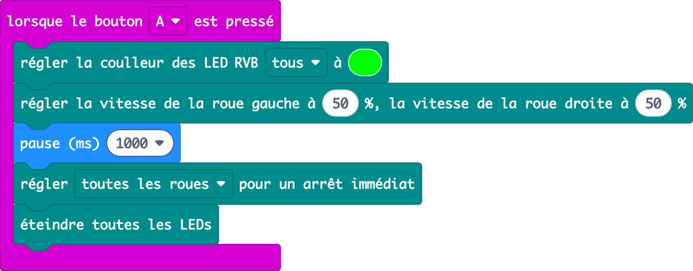
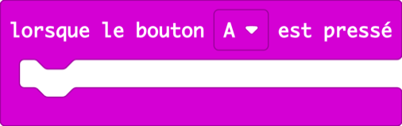
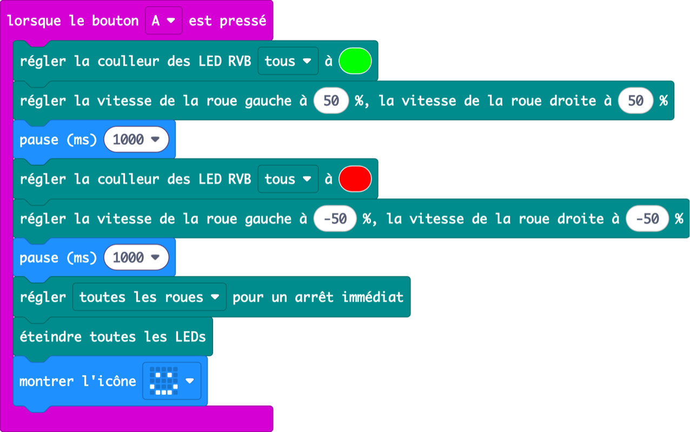
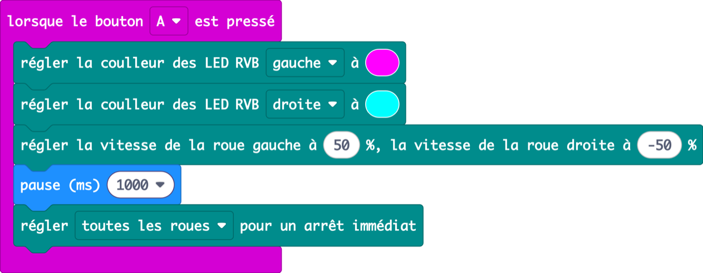
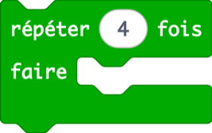
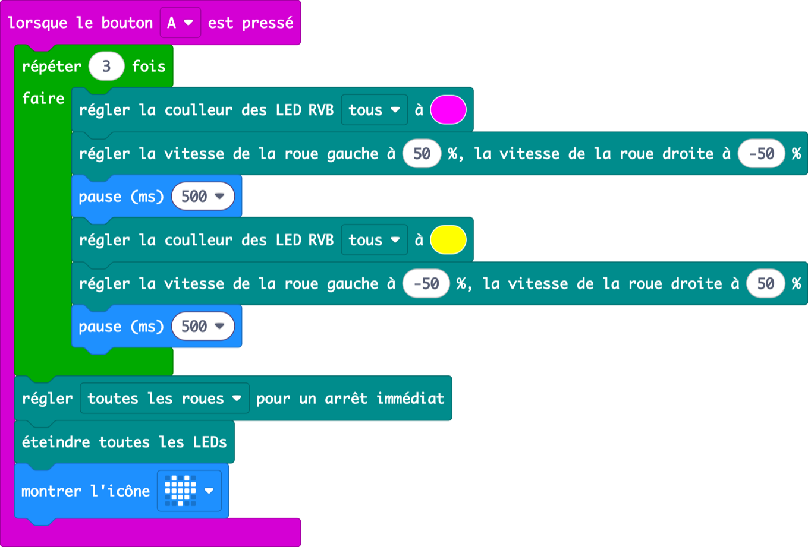
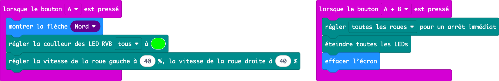
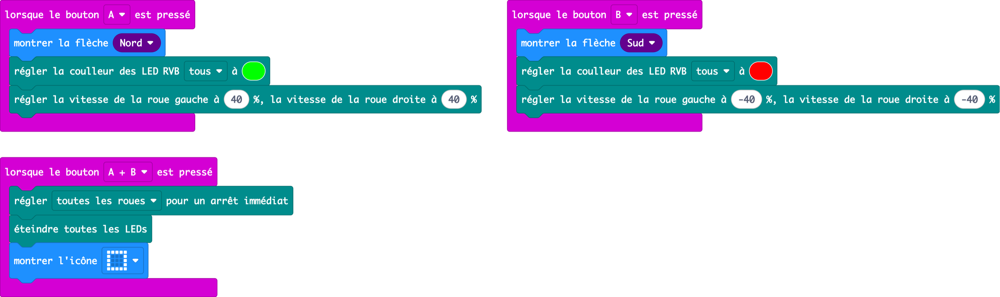

Leçon 2 · moteurs et lumières · 60 min

Le robot dort dans sa boîte depuis sa sortie d’usine. Aujourd’hui, il fait ses premiers pas, apprend à danser et à rouler avec ses boutons.

## Échauffement : vous vous souvenez du badge humeur ? (3 min)

Affichez le programme de la leçon 1. Demandez : « Qu’est-ce qui faisait changer le visage ? » (un appui sur un bouton, un **événement**). Aujourd’hui, ces mêmes boutons vont faire rouler le robot. Les élèves commencent un **nouveau projet** : ils doivent donc rajouter l’extension Cutebot Pro (rappelez les étapes de 1.3).


<details>
<summary>Copier le code de cette image (à coller dans la vue JavaScript de MakeCode)</summary>

```ts
input.onButtonPressed(Button.A, function () {
    basic.showIcon(IconNames.Happy)
    CutebotPro.colorLight(CutebotProRGBLight.RGBA, 0x00ff00)
})
input.onButtonPressed(Button.B, function () {
    basic.showIcon(IconNames.Sad)
    CutebotPro.colorLight(CutebotProRGBLight.RGBA, 0x0000ff)
})
```

</details>

---

## 2.1 Premiers pas

_18 min · vitesse des roues, pause, arrêt_

### Accroche (2 min)

> **Dites :** « Ce robot n’a jamais bougé de sa vie. Il n’a pas de jambes. Il a deux roues, et il a une horloge. Si je dis aux roues “roulez” et que je compte jusqu’à un… jusqu’où ira-t-il ? »

> **Demandez :** Levez la main : jusqu’où ira-t-il en une seconde ? Notez trois estimations au tableau.

### Démo (6 min)

1. Glissez **lorsque le bouton A est pressé** depuis Entrées (comme en leçon 1).
2. Dans Cutebot Pro, ajoutez **régler la coulleur des LED** et choisissez le vert.
3. Ajoutez **régler la vitesse de la roue gauche à 50 %, la vitesse de la roue droite à 50 %**. Expliquez : 100, c’est à fond ; 0, c’est à l’arrêt.
4. Ajoutez **pause (ms) 1000** depuis Base. « 1000 millisecondes, c’est une seconde. »
5. Ajoutez **régler toutes les roues pour un arrêt immédiat** et **éteindre toutes les LEDs**.
6. Lancez-le par terre. Mesurez la distance avec une règle et comparez avec les estimations.



<details>
<summary>Copier le code de cette image (à coller dans la vue JavaScript de MakeCode)</summary>

```ts
input.onButtonPressed(Button.A, function () {
    CutebotPro.colorLight(CutebotProRGBLight.RGBA, 0x00ff00)
    CutebotPro.pwmCruiseControl(50, 50)
    basic.pause(1000)
    CutebotPro.stopImmediately(CutebotProMotors.ALL)
    CutebotPro.turnOffAllHeadlights()
})
```

</details>

Point clé : **sans le bloc d’arrêt, le robot ne s’arrête jamais.** Les roues continuent de faire la dernière chose qu’on leur a dite. Enlevez-le (par terre !) pour le prouver.

### Pratique (10 min)

#### Défi

Faites faire à votre robot un pas en avant avec les phares verts, puis un pas en arrière avec les phares rouges, puis un sourire.

- Indice : pour reculer, utilisez une vitesse négative (**−50**).
- Revient-il exactement au même endroit ?

#### Les blocs dont vous aurez besoin

-  Base **(nouveau)**

-  Cutebot Pro

-  Cutebot Pro **(nouveau)**

-  Entrées

-  Cutebot Pro **(nouveau)**

-  Base

-  Cutebot Pro

Demandez-leur de retenir les couleurs : **vert veut dire avancer, rouge veut dire reculer**. Elles reviendront dans le projet final.

**Solution**



<details>
<summary>Copier le code de cette image (à coller dans la vue JavaScript de MakeCode)</summary>

```ts
input.onButtonPressed(Button.A, function () {
    CutebotPro.colorLight(CutebotProRGBLight.RGBA, 0x00ff00)
    CutebotPro.pwmCruiseControl(50, 50)
    basic.pause(1000)
    CutebotPro.colorLight(CutebotProRGBLight.RGBA, 0xff0000)
    CutebotPro.pwmCruiseControl(-50, -50)
    basic.pause(1000)
    CutebotPro.stopImmediately(CutebotProMotors.ALL)
    CutebotPro.turnOffAllHeadlights()
    basic.showIcon(IconNames.Happy)
})
```

</details>

#### Attention à

- Une vitesse trop faible peut ne pas suffire à faire tourner les roues. Commencez à 30 % ou plus.
- Il ne revient pas au même endroit : les roues glissent un peu. C’est normal, et cela mérite qu’on en discute.
- Des élèves mettent le signe moins sur une seule roue et le robot tourne sur lui-même. Gardez ça pour 2.2 !

#### Pour aller plus loin

- Prédisez, puis testez : jusqu’où va-t-il en 2000 ms ? À 100 % ?
- Faites-le s’arrêter pile sur la ligne de parking.

---

## 2.2 Soirée dansante

_18 min · tourner, boucle répéter_

### Accroche (2 min)

> **Dites :** « Notre robot est invité à un concours de danse. Problème : il ne connaît que “avancer” et “reculer”. Apprenons-lui à tourner. »

> **Demandez :** Posez vos deux poings sur la table : ce sont les roues. Les deux roulent vers l’avant : on va tout droit. Que se passe-t-il si un poing avance et l’autre recule ?

### Démo (6 min)

1. Réglez la **roue gauche à 50** et la **roue droite à −50**. Le robot tourne sur place.
2. Montrez que chaque phare peut avoir sa couleur : choisissez **RVB gauche** et **RVB droite** dans le menu.
3. Demandez : « Dans quel sens tournera-t-il si j’inverse les nombres ? » Lancez-le pour vérifier.



<details>
<summary>Copier le code de cette image (à coller dans la vue JavaScript de MakeCode)</summary>

```ts
input.onButtonPressed(Button.A, function () {
    CutebotPro.colorLight(CutebotProRGBLight.RGBL, 0xff00ff)
    CutebotPro.colorLight(CutebotProRGBLight.RGBR, 0x00ffff)
    CutebotPro.pwmCruiseControl(50, -50)
    basic.pause(1000)
    CutebotPro.stopImmediately(CutebotProMotors.ALL)
})
```

</details>

### Pratique (10 min)

#### Défi

Créez une chorégraphie : tourner dans un sens, puis dans l’autre, trois fois de suite. Changez la couleur des phares à chaque mouvement et terminez par un cœur.

- Nouveau bloc : **répéter 4 fois** dans Boucles. Changez-le en 3.
- Les mouvements dans le répéter se font encore et encore. Ceux qui suivent, une seule fois.

#### Les blocs dont vous aurez besoin

-  Cutebot Pro

-  Base

-  Boucles **(nouveau)**

-  Cutebot Pro

-  Cutebot Pro

-  Base

-  Entrées

-  Cutebot Pro

**Solution**



<details>
<summary>Copier le code de cette image (à coller dans la vue JavaScript de MakeCode)</summary>

```ts
input.onButtonPressed(Button.A, function () {
    for (let index = 0; index < 3; index++) {
        CutebotPro.colorLight(CutebotProRGBLight.RGBA, 0xff00ff)
        CutebotPro.pwmCruiseControl(50, -50)
        basic.pause(500)
        CutebotPro.colorLight(CutebotProRGBLight.RGBA, 0xffff00)
        CutebotPro.pwmCruiseControl(-50, 50)
        basic.pause(500)
    }
    CutebotPro.stopImmediately(CutebotProMotors.ALL)
    CutebotPro.turnOffAllHeadlights()
    basic.showIcon(IconNames.Heart)
})
```

</details>

#### Attention à

- Le bloc d’arrêt finit dans le répéter et la danse est saccadée. Demandez : « Qu’est-ce qui ne doit arriver qu’une fois ? »
- Des pauses de 100 ms sont trop rapides pour être vues. Prenez 300 ms ou plus.

#### Pour aller plus loin

- Avec un micro:bit V2, ajoutez une mélodie (catégorie Musique) avant le répéter.
- Ajoutez un petit saut : un court aller-retour entre deux tours.
- Concours de danse : deux robots côte à côte, même code, lequel reste en rythme ?

---

## 2.3 Pilote à boutons

_18 min · événements, flèches_

### Accroche (2 min)

> **Dites :** « Jusqu’ici, le robot faisait une danse prévue à l’avance. Maintenant, c’est **vous** qui conduisez. En leçon 1, le bouton A voulait dire “content”. Que devrait vouloir dire le bouton A pour une voiture ? »

> **Demandez :** Si on appuie sur A et que le robot démarre, quand va-t-il s’arrêter ?

### Démo (6 min)

1. Bouton A : flèche Nord, phares verts, les deux roues à 40 %. **Pas de pause, pas d’arrêt.**
2. Bouton A + B : arrêt, phares éteints, effacer l’écran.
3. Appuyez sur A et éloignez-vous. Le robot continue : « les moteurs retiennent le dernier ordre ». Les boutons sont sur le robot : le conducteur marche à côté pour appuyer sur A + B.



<details>
<summary>Copier le code de cette image (à coller dans la vue JavaScript de MakeCode)</summary>

```ts
input.onButtonPressed(Button.A, function () {
    basic.showArrow(ArrowNames.North)
    CutebotPro.colorLight(CutebotProRGBLight.RGBA, 0x00ff00)
    CutebotPro.pwmCruiseControl(40, 40)
})
input.onButtonPressed(Button.AB, function () {
    CutebotPro.stopImmediately(CutebotProMotors.ALL)
    CutebotPro.turnOffAllHeadlights()
    basic.clearScreen()
})
```

</details>

### Pratique (10 min)

#### Défi

Terminez votre pilote à boutons : le bouton B fait reculer avec les phares rouges et une flèche Sud. A + B arrête et montre un carré.

- Jeu du parking : partez de la ligne de départ, garez-vous le plus près possible de la ligne de parking. Le binôme le plus proche gagne.

#### Les blocs dont vous aurez besoin

-  Cutebot Pro

-  Base **(nouveau)**

-  Cutebot Pro

-  Entrées

-  Cutebot Pro

-  Base

-  Cutebot Pro

**Solution**



<details>
<summary>Copier le code de cette image (à coller dans la vue JavaScript de MakeCode)</summary>

```ts
input.onButtonPressed(Button.A, function () {
    basic.showArrow(ArrowNames.North)
    CutebotPro.colorLight(CutebotProRGBLight.RGBA, 0x00ff00)
    CutebotPro.pwmCruiseControl(40, 40)
})
input.onButtonPressed(Button.B, function () {
    basic.showArrow(ArrowNames.South)
    CutebotPro.colorLight(CutebotProRGBLight.RGBA, 0xff0000)
    CutebotPro.pwmCruiseControl(-40, -40)
})
input.onButtonPressed(Button.AB, function () {
    CutebotPro.stopImmediately(CutebotProMotors.ALL)
    CutebotPro.turnOffAllHeadlights()
    basic.showIcon(IconNames.Square)
})
```

</details>

#### Attention à

- Si on appuie sur A puis sur B, c’est l’événement A (ou B) qui se déclenche d’abord. Appuyez sur les deux exactement en même temps.
- Le robot est branché à l’ordinateur et tombe de la table. Débranchez avant de tester !

#### Pour aller plus loin

- micro:bit V2 : utilisez l’événement du logo (Entrées) pour tourner sur place.
- Utilisez l’événement « secouer » pour faire clignoter les phares comme un klaxon.

### Bilan (3 min)

> **Dites :** « Aujourd’hui, vous avez conduit le robot. Mais il est aveugle : il foncerait droit dans un mur. À la prochaine séance, le robot acquiert des sens. »

---
[← Leçon 1](/fr-CA/exercises/makecode/robotics/cutebot/lesson-1/) [Leçon 3 : Le robot voit →](/fr-CA/exercises/makecode/robotics/cutebot/lesson-3/)
