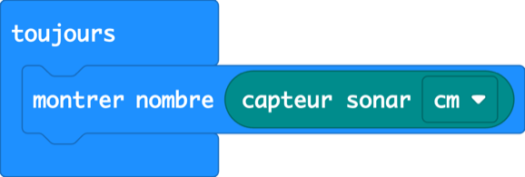
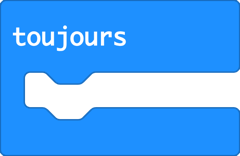
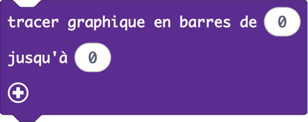
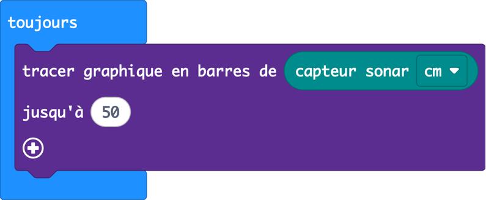
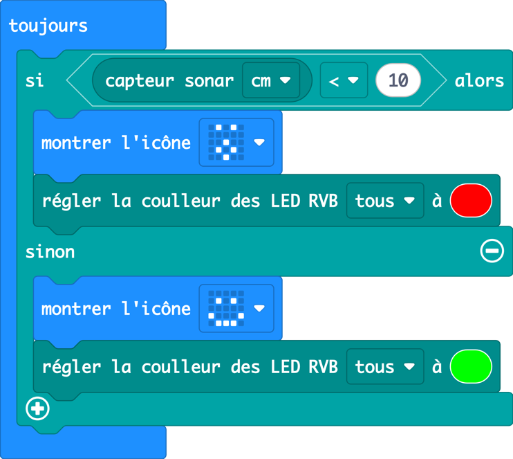
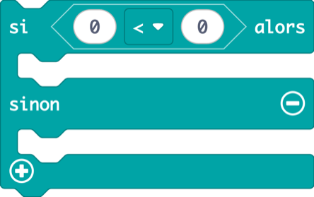
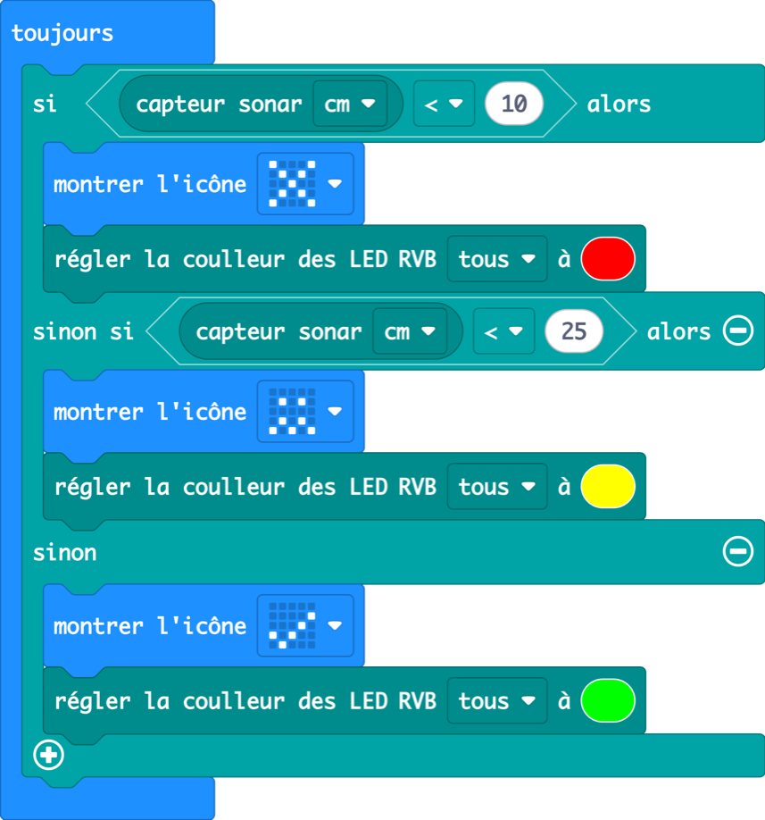
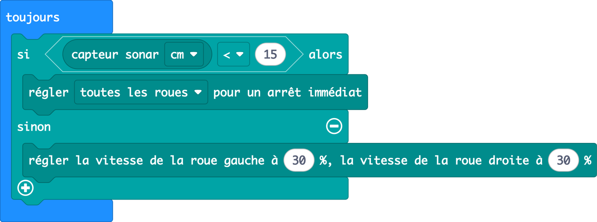
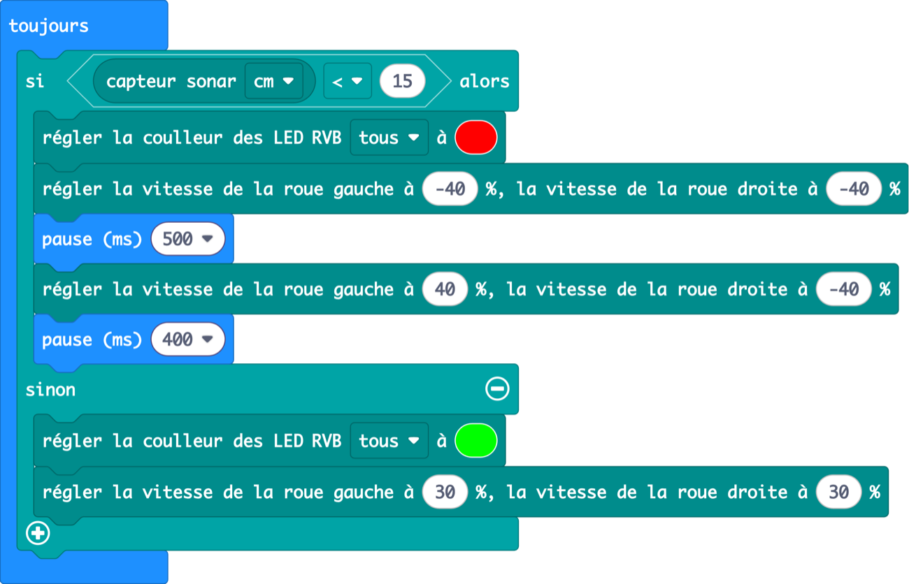

Leçon 3 · capteurs et décisions · 60 min

Les deux « yeux » ronds à l’avant ne sont pas des yeux. Ils fonctionnent comme les oreilles d’une chauve-souris. Aujourd’hui, le robot mesure les distances et commence à prendre ses propres décisions.

## Échauffement : conduire avec les boutons de la leçon 2 (3 min)

Les binômes téléchargent leur pilote à boutons de la leçon 2 et conduisent leur robot quelques minutes. Demandez : « La dernière fois, votre robot a foncé dans le mur. Pourquoi ne s’est-il pas arrêté tout seul ? » Il ne voit pas encore, et c’est le sujet d’aujourd’hui.

---

## 3.1 Oreilles de chauve-souris

_17 min · capteur sonar, toujours_

### Accroche (2 min)

> **Dites :** « Les chauves-souris volent dans le noir complet sans se cogner. Elles crient et écoutent l’écho. Notre robot fait exactement pareil. L’un des cercles est un minuscule haut-parleur qui crie un son trop aigu pour nous. L’autre est un micro qui écoute l’écho. »

> **Demandez :** Si l’écho revient très vite, le mur est-il proche ou loin ?

### Démo (6 min)

1. Présentez **toujours** : « il s’exécute encore et encore, tant que le robot est allumé ». Un capteur doit être lu tout le temps, pas une seule fois.
2. Mettez **montrer nombre** dedans, et déposez le bloc rond **capteur sonar cm** dans son trou. Les blocs ronds sont des **valeurs** : ils rentrent dans les trous.
3. Bougez la main devant le robot et regardez le nombre changer.



<details>
<summary>Copier le code de cette image (à coller dans la vue JavaScript de MakeCode)</summary>

```ts
basic.forever(function () {
    basic.showNumber(CutebotPro.ultrasonic(SonarUnit.Centimeters))
})
```

</details>

**Détective des distances (jeu de 3 min) :** annoncez une distance (« 17 cm ! »). Les binômes font la course pour placer une main exactement à cette distance, puis vérifient à la règle.

### Pratique (9 min)

#### Défi

Transformez l’écran en indicateur de distance : plus votre main est loin, plus il y a de LED allumées.

- Nouveau bloc : **tracer graphique en barres de … jusqu’à …** (dans Led). Mettez le bloc sonar dans le premier trou et 50 dans le second.

#### Les blocs dont vous aurez besoin

-  Cutebot Pro **(nouveau)**

-  Base

-  Led **(nouveau)**

**Solution**



<details>
<summary>Copier le code de cette image (à coller dans la vue JavaScript de MakeCode)</summary>

```ts
basic.forever(function () {
    led.plotBarGraph(CutebotPro.ultrasonic(SonarUnit.Centimeters), 50)
})
```

</details>

#### Attention à

- Les objets mous (pulls, coussins) absorbent le son et donnent des nombres bizarres. Les surfaces plates et dures marchent le mieux.
- Le capteur affiche **0** quand il n’entend aucun écho (rien devant, ou trop loin). À retenir pour la leçon 4 !

#### Pour aller plus loin

- Remplacez « jusqu’à 50 » par 20. Qu’est-ce qui change ?
- Quelle est la plus petite distance que le capteur peut mesurer ? La plus grande ?

---

## 3.2 Radar de recul

_19 min · si / sinon, sinon si, comparer des nombres_

### Accroche (2 min)

> **Dites :** « Quand une voiture se gare en marche arrière, elle bipe de plus en plus vite en s’approchant du mur. Les vraies voitures utilisent le même genre de capteur que votre robot. »

> **Demandez :** Comment la voiture décide-t-elle quand biper ? Quelle question se pose-t-elle, encore et encore ?

Amenez-les à la question : **« Le mur est-il plus près que … ? »** Cette question, c’est un **si**.

### Démo (7 min)

1. Dans Logique, prenez **si … alors … sinon**. Mettez-le dans un toujours.
2. Dans Logique, prenez la comparaison **0 &lt; 0**. Mettez le bloc sonar à gauche et tapez 10 à droite.
3. Si plus près que 10 : visage surpris, phares rouges. Sinon : visage content, phares verts.
4. Lisez le programme à voix haute, comme une phrase. Les élèves adorent découvrir qu’un programme se lit comme une phrase.



<details>
<summary>Copier le code de cette image (à coller dans la vue JavaScript de MakeCode)</summary>

```ts
basic.forever(function () {
    if (CutebotPro.ultrasonic(SonarUnit.Centimeters) < 10) {
        basic.showIcon(IconNames.Surprised)
        CutebotPro.colorLight(CutebotProRGBLight.RGBA, 0xff0000)
    } else {
        basic.showIcon(IconNames.Happy)
        CutebotPro.colorLight(CutebotProRGBLight.RGBA, 0x00ff00)
    }
})
```

</details>

### Pratique (10 min)

#### Défi

Fabriquez un radar de recul à trois zones : ✗ rouge tout près (moins de 10 cm), jaune quand on s’approche (moins de 25 cm), et ✓ vert quand la voie est libre.

- Cliquez sur le **+** en bas du bloc si pour ajouter un **sinon si**.

#### Les blocs dont vous aurez besoin

-  Cutebot Pro

-  Logique **(nouveau)**

-  Cutebot Pro

-  Base

-  Base

**Solution**



<details>
<summary>Copier le code de cette image (à coller dans la vue JavaScript de MakeCode)</summary>

```ts
basic.forever(function () {
    if (CutebotPro.ultrasonic(SonarUnit.Centimeters) < 10) {
        basic.showIcon(IconNames.No)
        CutebotPro.colorLight(CutebotProRGBLight.RGBA, 0xff0000)
    } else if (CutebotPro.ultrasonic(SonarUnit.Centimeters) < 25) {
        basic.showIcon(IconNames.Confused)
        CutebotPro.colorLight(CutebotProRGBLight.RGBA, 0xffff00)
    } else {
        basic.showIcon(IconNames.Yes)
        CutebotPro.colorLight(CutebotProRGBLight.RGBA, 0x00ff00)
    }
})
```

</details>

#### Attention à

- **L’ordre compte.** Si les élèves testent « moins de 25 » en premier, la zone rouge n’arrive jamais, car 5 est aussi inférieur à 25 ! Idéal pour 2 minutes de discussion en classe.
- Le bloc sonar est utilisé deux fois. Ce n’est pas grave aujourd’hui. En leçon 4, on corrige ça avec une variable.

#### Pour aller plus loin

- micro:bit V2 : jouez une note (catégorie Musique) dans la zone rouge pour biper comme une vraie voiture.
- Ajoutez une quatrième zone avec une nouvelle couleur.

---

## 3.3 Rover martien

_18 min · capter + rouler, éviter les obstacles_

### Accroche (2 min)

> **Dites :** « Un rover sur Mars n’a pas de conducteur. Un message radio envoyé depuis la Terre met entre 4 et 24 minutes à arriver : bien trop lent pour crier “STOP !”. Alors le rover doit regarder et décider tout seul. »

> **Demandez :** Quelles sont les deux choses que le rover doit faire encore et encore ? (Regarder. Décider.)

### Démo (6 min)

1. Reprenez le si/sinon de 3.2. Cette fois, la décision commande les roues, pas l’écran.
2. Plus près que 15 cm : arrêt. Sinon : rouler à 30 %.
3. Tenez un livre devant le robot, puis éloignez-le doucement. Le robot suit le livre et s’arrête. (C’est un avant-goût de la leçon 4, ne le leur dites pas !)



<details>
<summary>Copier le code de cette image (à coller dans la vue JavaScript de MakeCode)</summary>

```ts
basic.forever(function () {
    if (CutebotPro.ultrasonic(SonarUnit.Centimeters) < 15) {
        CutebotPro.stopImmediately(CutebotProMotors.ALL)
    } else {
        CutebotPro.pwmCruiseControl(30, 30)
    }
})
```

</details>

### Pratique (10 min)

#### Défi

Construisez un rover martien qui explore un labyrinthe de livres. Quand quelque chose est proche : phares rouges, reculer, tourner, puis repartir explorer avec les phares verts.

- Construisez un petit labyrinthe par terre avec des livres et des sacs.

#### Les blocs dont vous aurez besoin

-  Cutebot Pro

-  Cutebot Pro

-  Base

-  Base

-  Logique

-  Cutebot Pro

**Solution**



<details>
<summary>Copier le code de cette image (à coller dans la vue JavaScript de MakeCode)</summary>

```ts
basic.forever(function () {
    if (CutebotPro.ultrasonic(SonarUnit.Centimeters) < 15) {
        CutebotPro.colorLight(CutebotProRGBLight.RGBA, 0xff0000)
        CutebotPro.pwmCruiseControl(-40, -40)
        basic.pause(500)
        CutebotPro.pwmCruiseControl(40, -40)
        basic.pause(400)
    } else {
        CutebotPro.colorLight(CutebotProRGBLight.RGBA, 0x00ff00)
        CutebotPro.pwmCruiseControl(30, 30)
    }
})
```

</details>

#### Attention à

- **Pas de montrer l’icône dans une boucle de déplacement.** Chaque image prend environ une demi-seconde, pendant laquelle le robot roule à l’aveugle. Utilisez les phares pour montrer ce qu’il fait.
- Le robot tourne sans fin : la pause du virage est trop longue ou la vitesse trop élevée.

#### Pour aller plus loin

- Utilisez **choisir au hasard** (Maths) pour tourner parfois à gauche, parfois à droite.
- Course : qui sort du labyrinthe le plus vite sans toucher de mur ?

### Bilan (3 min)

> **Dites :** « Votre rover _fuit_ les obstacles. À la prochaine séance, il fera le contraire : il vous suivra comme un chiot, et s’arrêtera avant de vous rentrer dedans. »

---
[← Leçon 2](/fr-CA/exercises/makecode/robotics/cutebot/lesson-2/) [Leçon 4 : Suis-moi ! →](/fr-CA/exercises/makecode/robotics/cutebot/lesson-4/)
