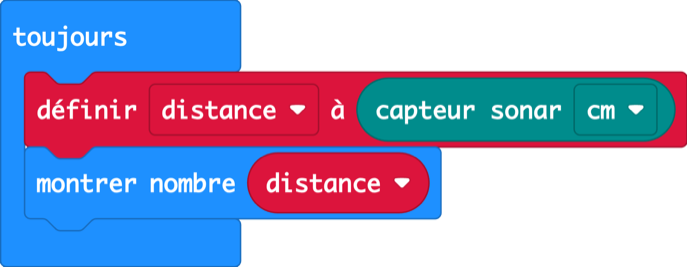
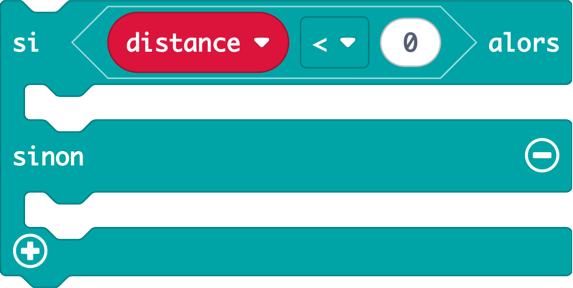
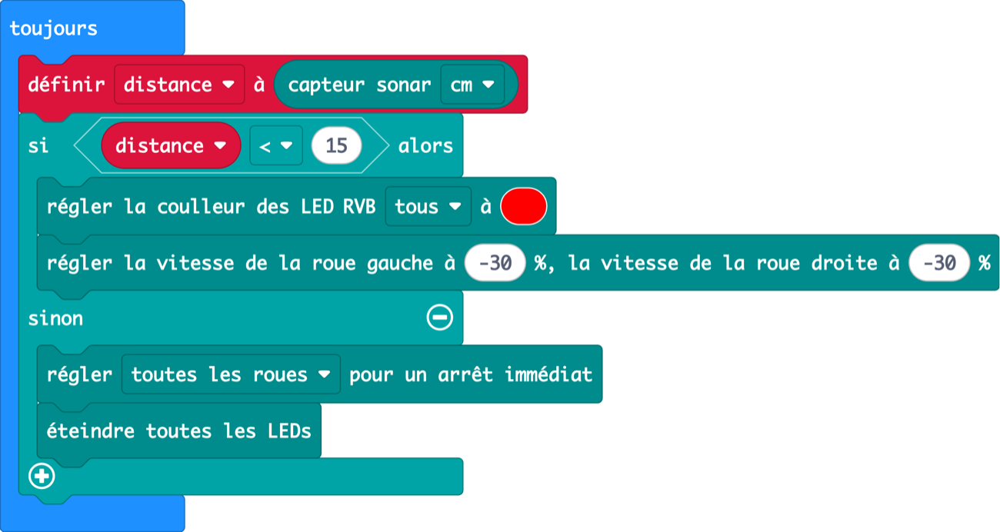
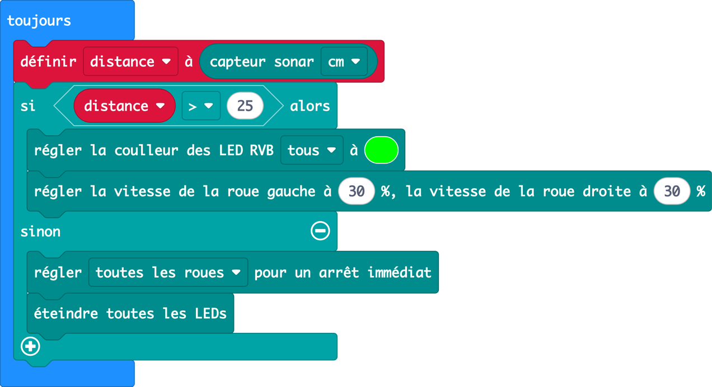
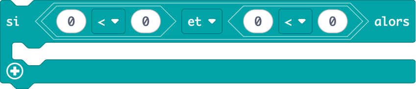
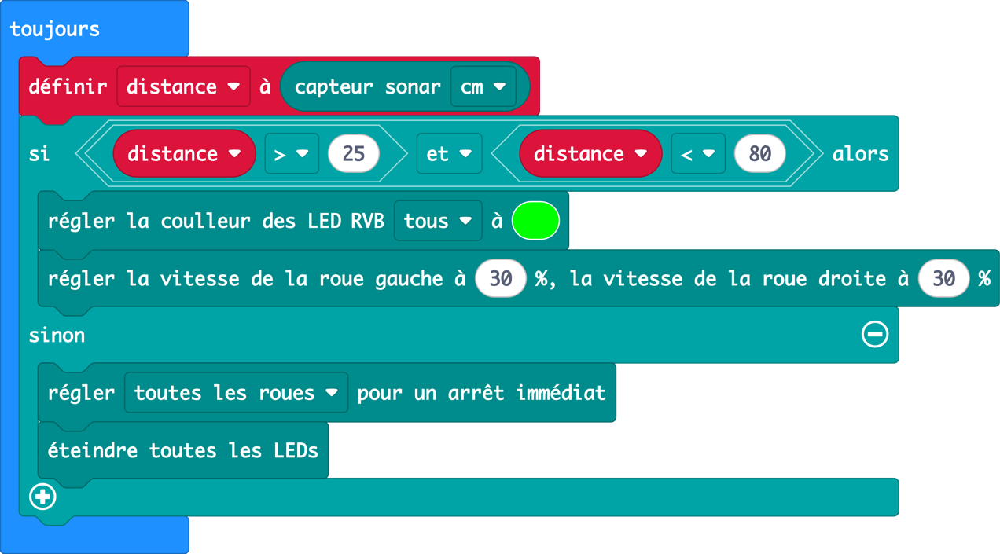
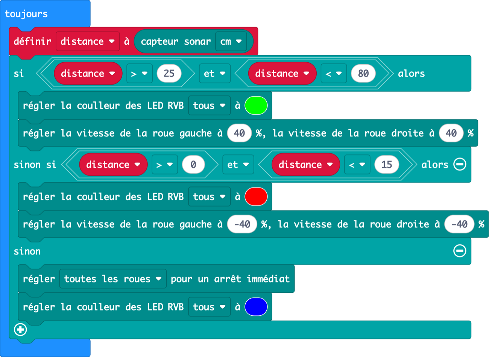
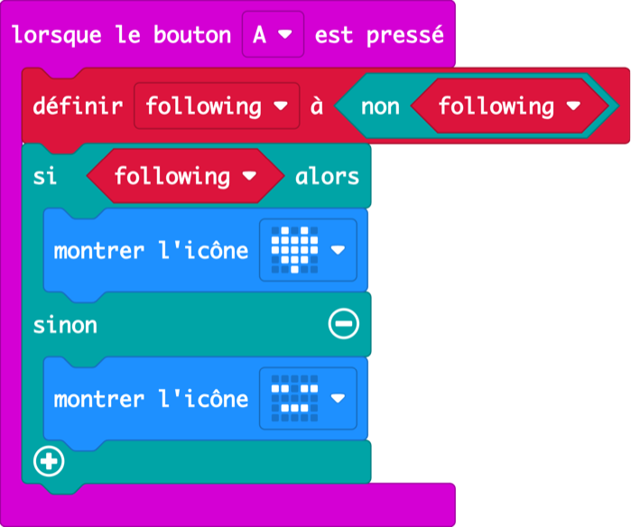
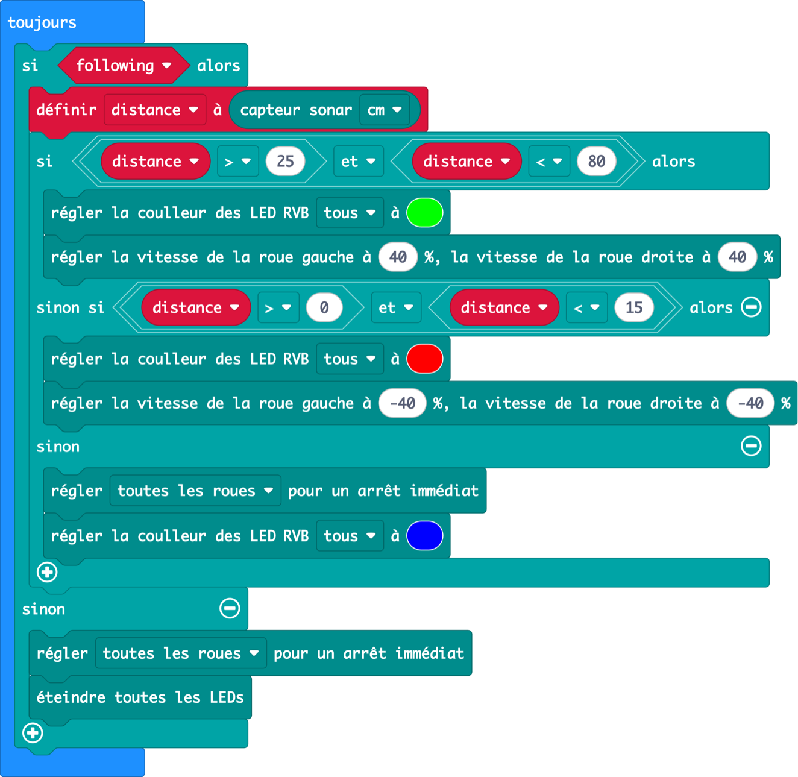

Leçon 4 · variables et projet final · 60 min

D’abord un robot timide qui recule, puis un chiot curieux qui s’approche. Assemblez les deux et vous obtenez un robot qui vous suit et s’arrête à la bonne distance.

## Échauffement : le robot humain (5 min, sans ordinateur)

Par deux. Un élève est le robot et tend les mains à plat devant lui : c’est le sonar. L’autre lève une paume comme cible et se déplace lentement. Règles au tableau :

- **Trop loin** → le robot fait un pas en **avant** (il dit « vert ! »)
- **Trop près** → le robot fait un pas en **arrière** (il dit « rouge ! »)
- **À la bonne distance** → le robot **se fige**

Puis : **« Ces trois règles, c’est tout le programme final. Apprenons-les au Cutebot, une règle à la fois. »**

---

## 4.1 Robot timide

_13 min · variables, reculer_

### Accroche (2 min)

> **Dites :** « Notre robot est timide. Si on s’approche trop, il recule. Mais d’abord, il lui faut une mémoire. Pour l’instant, il mesure et oublie aussitôt. Pour le radar de recul, on a dû mesurer deux fois ! »

> **Demandez :** Quand on mesure quelque chose et qu’on veut s’en souvenir, que fait-on ? (On le note. Une variable, c’est le bloc-notes du robot.)

### Démo (4 min)

1. Variables → **Créer une variable…** → nommez-la `distance`.
2. En haut du toujours : **définir distance à** sonar. Puis **montrer nombre distance**.
3. Imaginez une boîte avec une étiquette : à chaque tour de boucle, on jette l’ancien nombre et on met le nouveau.



<details>
<summary>Copier le code de cette image (à coller dans la vue JavaScript de MakeCode)</summary>

```ts
let distance = 0
basic.forever(function () {
    distance = CutebotPro.ultrasonic(SonarUnit.Centimeters)
    basic.showNumber(distance)
})
```

</details>

### Pratique (7 min)

#### Défi

Rendez le robot timide : quand vous êtes à moins de 15 cm, il recule avec les phares rouges. Sinon, il reste immobile, phares éteints.

- Utilisez votre variable `distance` dans le si, pas le bloc sonar.

#### Les blocs dont vous aurez besoin

-  Logique · Variables **(nouveau)**

-  Cutebot Pro

-  Cutebot Pro

-  Variables **(nouveau)**

-  Cutebot Pro

-  Base

-  Cutebot Pro

-  Cutebot Pro

**Solution**



<details>
<summary>Copier le code de cette image (à coller dans la vue JavaScript de MakeCode)</summary>

```ts
let distance = 0
basic.forever(function () {
    distance = CutebotPro.ultrasonic(SonarUnit.Centimeters)
    if (distance < 15) {
        CutebotPro.colorLight(CutebotProRGBLight.RGBA, 0xff0000)
        CutebotPro.pwmCruiseControl(-30, -30)
    } else {
        CutebotPro.stopImmediately(CutebotProMotors.ALL)
        CutebotPro.turnOffAllHeadlights()
    }
})
```

</details>

#### Attention à

- Si **définir distance** est dans _au démarrage_, la mesure n’a lieu qu’une fois. Il doit être dans toujours, tout en haut.
- Le robot recule alors qu’il n’y a rien devant : c’est la mesure **0** de 3.1 (pas d’écho donne 0, et 0 est inférieur à 15). Gardez ça pour le projet final.

#### Pour aller plus loin

- Encore plus timide : 30 cm.
- Timide _et_ poli : montrez un visage surpris quand il recule (mais l’écran est lent !).

---

## 4.2 Chiot curieux

_13 min · « et », intervalles_

### Accroche (2 min)

> **Dites :** « Maintenant, l’inverse : un chiot curieux. Quand vous vous éloignez, il trottine derrière vous. Mais un bon chiot ne court pas après le mur au fond de la salle. »

### Démo (4 min)

1. Inversez le robot timide : si la distance est **supérieure à 25**, avancer avec les phares verts.
2. Lancez-le dans un espace dégagé, face à un mur lointain. Oups : il roule jusqu’au mur.



<details>
<summary>Copier le code de cette image (à coller dans la vue JavaScript de MakeCode)</summary>

```ts
let distance = 0
basic.forever(function () {
    distance = CutebotPro.ultrasonic(SonarUnit.Centimeters)
    if (distance > 25) {
        CutebotPro.colorLight(CutebotProRGBLight.RGBA, 0x00ff00)
        CutebotPro.pwmCruiseControl(30, 30)
    } else {
        CutebotPro.stopImmediately(CutebotProMotors.ALL)
        CutebotPro.turnOffAllHeadlights()
    }
})
```

</details>

> **Demandez :** Comment dire au robot « loin, mais pas _trop_ loin » ?

### Pratique (7 min)

#### Défi

Apprenez au chiot à ne vous suivre que si vous êtes à plus de 25 cm **et** à moins de 80 cm.

- Nouveau bloc : **et** dans Logique. Chaque côté contient une comparaison.

#### Les blocs dont vous aurez besoin

-  Cutebot Pro

-  Logique **(nouveau)**

-  Cutebot Pro

-  Variables

-  Base

-  Cutebot Pro

-  Logique · Variables

-  Cutebot Pro

-  Cutebot Pro

**Solution**



<details>
<summary>Copier le code de cette image (à coller dans la vue JavaScript de MakeCode)</summary>

```ts
let distance = 0
basic.forever(function () {
    distance = CutebotPro.ultrasonic(SonarUnit.Centimeters)
    if (distance > 25 && distance < 80) {
        CutebotPro.colorLight(CutebotProRGBLight.RGBA, 0x00ff00)
        CutebotPro.pwmCruiseControl(30, 30)
    } else {
        CutebotPro.stopImmediately(CutebotProMotors.ALL)
        CutebotPro.turnOffAllHeadlights()
    }
})
```

</details>

#### Attention à

- Des élèves prennent **ou** au lieu de **et** : alors toutes les distances conviennent, et le chiot recommence à poursuivre les murs.
- Les signes &lt; et > sont inversés. Lisez à voix haute : « distance est plus grande que 25 ».

#### Pour aller plus loin

- Tenez un cahier et reculez lentement. Arrivez-vous à guider le chiot à travers la salle ?
- Commencez le projet final en avance !

---

## Final Suis-moi, Cutebot

_24 min · tout ensemble_

### Accroche (2 min)

> **Dites :** « Vous avez construit un robot timide et un chiot curieux. Un chiot timide qui est aussi curieux… c’est un robot qui vous suit en gardant une distance de sécurité. Comme dans le jeu du robot humain. Construisons-le. »

### Planifier (4 min)

Dessinez ceci au tableau. Chaque distance appartient à une seule zone :

| Mesure du sonar | Ce que fait le robot | Phares |
| --- | --- | --- |
| 0 (rien détecté) | Arrêt | Bleu |
| 1 à 15 cm | Reculer | Rouge |
| 15 à 25 cm | Rester | Bleu |
| 25 à 80 cm | Suivre | Vert |
| Plus de 80 cm (perdu) | Arrêt | Bleu |

**Pourquoi une zone « rester » ?** Demandez ce qui se passerait si « suivre » et « reculer » utilisaient le même nombre, disons 20 cm. Le robot ferait des allers-retours sans fin (à tester pour aller plus loin !). L’écart lui donne un endroit où se reposer. Les thermostats de chauffage utilisent la même astuce.

### Pratique (18 min)

#### Projet final

Programmez votre robot pour qu’il vous suive. Trop loin : avancer avec les phares verts. Trop près : reculer avec les phares rouges. À la bonne distance, ou perdu : s’arrêter avec les phares bleus.

- Testez avec un cahier tenu bas, à la hauteur du sonar du robot, et marchez lentement.

#### Les blocs dont vous aurez besoin

-  Cutebot Pro

-  Logique

-  Cutebot Pro

-  Variables

-  Cutebot Pro

-  Cutebot Pro

-  Logique · Variables

-  Base

Donnez les indices un par un, seulement quand un binôme est bloqué :

1. Partez de votre programme Chiot curieux. Il fait déjà la partie verte.
2. Cliquez sur le **+** du bloc si pour ajouter un **sinon si** pour « trop près ».
3. Copiez les blocs rouges de votre Robot timide dans le sinon si.
4. Le robot recule alors qu’il n’y a rien devant ? Souvenez-vous du **0** : « trop près » doit être _plus de 0 **et** moins de 15_.

**Solution**



<details>
<summary>Copier le code de cette image (à coller dans la vue JavaScript de MakeCode)</summary>

```ts
let distance = 0
basic.forever(function () {
    distance = CutebotPro.ultrasonic(SonarUnit.Centimeters)
    if (distance > 25 && distance < 80) {
        CutebotPro.colorLight(CutebotProRGBLight.RGBA, 0x00ff00)
        CutebotPro.pwmCruiseControl(40, 40)
    } else if (distance > 0 && distance < 15) {
        CutebotPro.colorLight(CutebotProRGBLight.RGBA, 0xff0000)
        CutebotPro.pwmCruiseControl(-40, -40)
    } else {
        CutebotPro.stopImmediately(CutebotProMotors.ALL)
        CutebotPro.colorLight(CutebotProRGBLight.RGBA, 0x0000ff)
    }
})
```

</details>

#### Attention à

- Le sonar est bas et étroit : les jambes et les vêtements amples donnent des mesures instables. Un cahier marche le mieux.
- Le robot réagit en retard : vérifiez qu’il n’y a ni **montrer l’icône** ni **pause** dans le toujours.
- À grande vitesse (au-delà d’environ 60 %), il dépasse la cible et la percute.

#### Pour aller plus loin

- L’expérience des allers-retours : mettez les deux nombres à 20 et observez.
- Réglages : quelle vitesse et quelles distances font le plus « vrai animal » ?
- Mode veille : le bouton A active et désactive le suivi (solution ci-dessous).

**Bonus : mode veille avec le bouton A**

Une variable vrai/faux `following` retient si le robot est réveillé. Le bloc **non** l’inverse à chaque appui.



<details>
<summary>Copier le code de cette image (à coller dans la vue JavaScript de MakeCode)</summary>

```ts
let following = false
input.onButtonPressed(Button.A, function () {
    following = !(following)
    if (following) {
        basic.showIcon(IconNames.Heart)
    } else {
        basic.showIcon(IconNames.Asleep)
    }
})
```

</details>



<details>
<summary>Copier le code de cette image (à coller dans la vue JavaScript de MakeCode)</summary>

```ts
let distance = 0
let following = false
basic.forever(function () {
    if (following) {
        distance = CutebotPro.ultrasonic(SonarUnit.Centimeters)
        if (distance > 25 && distance < 80) {
            CutebotPro.colorLight(CutebotProRGBLight.RGBA, 0x00ff00)
            CutebotPro.pwmCruiseControl(40, 40)
        } else if (distance > 0 && distance < 15) {
            CutebotPro.colorLight(CutebotProRGBLight.RGBA, 0xff0000)
            CutebotPro.pwmCruiseControl(-40, -40)
        } else {
            CutebotPro.stopImmediately(CutebotProMotors.ALL)
            CutebotPro.colorLight(CutebotProRGBLight.RGBA, 0x0000ff)
        }
    } else {
        CutebotPro.stopImmediately(CutebotProMotors.ALL)
        CutebotPro.turnOffAllHeadlights()
    }
})
```

</details>

### Défilé (5 min)

Tout le monde pose son robot sur la ligne de départ, tient un cahier devant lui et traverse lentement la salle en file. Les robots qui arrivent de l’autre côté ont leur nom inscrit au tableau d’honneur « Suis-moi ».

> **Dites :** « Il y a quatre séances, vous avez fait battre un cœur. Aujourd’hui, votre robot vous voit, décide quoi faire et vous suit. Certains robots dans les entrepôts et les hôpitaux font exactement cela, avec la même idée que celle que vous venez de construire. »

---
[← Leçon 3](/fr-CA/exercises/makecode/robotics/cutebot/lesson-3/) [Dépannage →](/fr-CA/exercises/makecode/robotics/cutebot/troubleshooting/)
